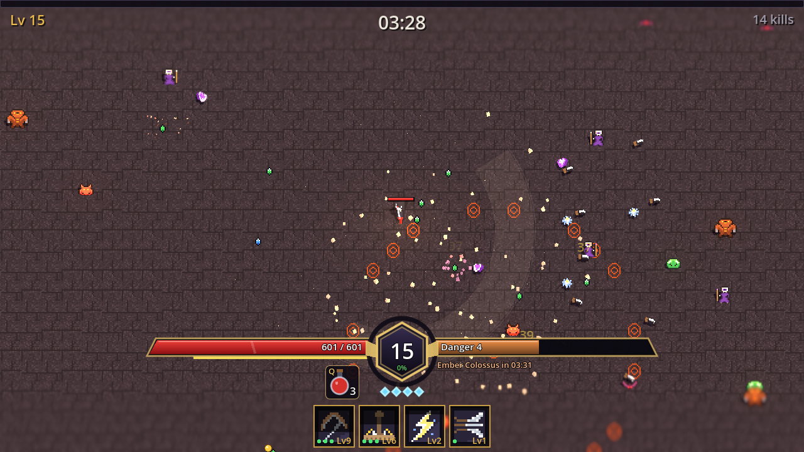
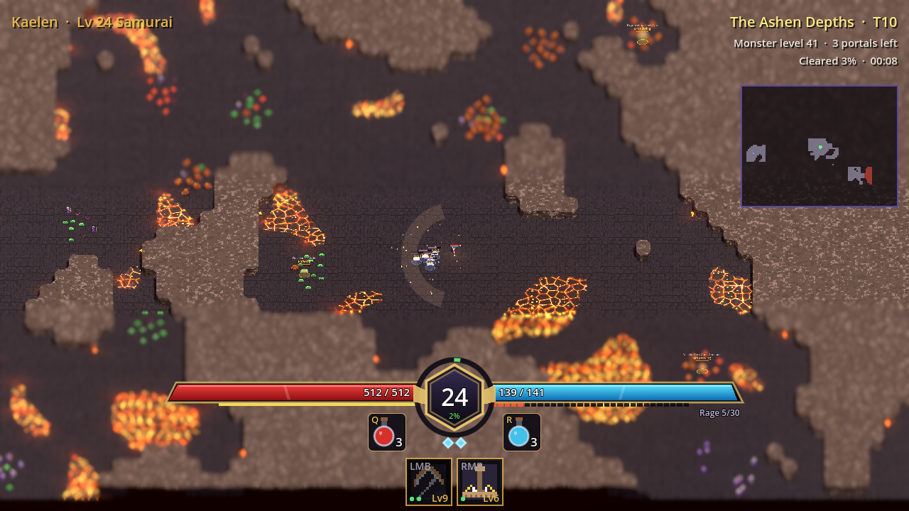
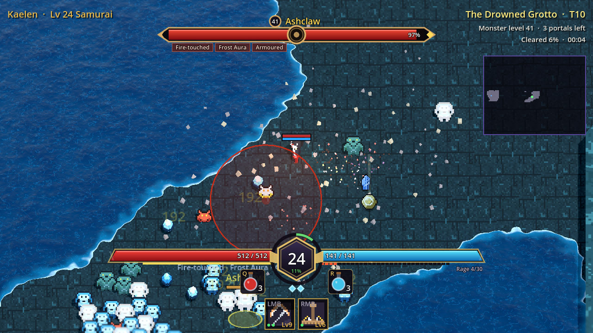
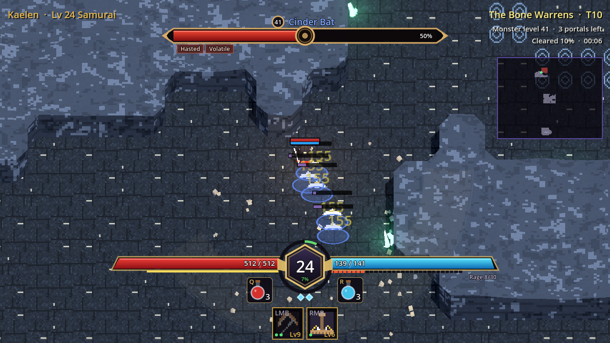
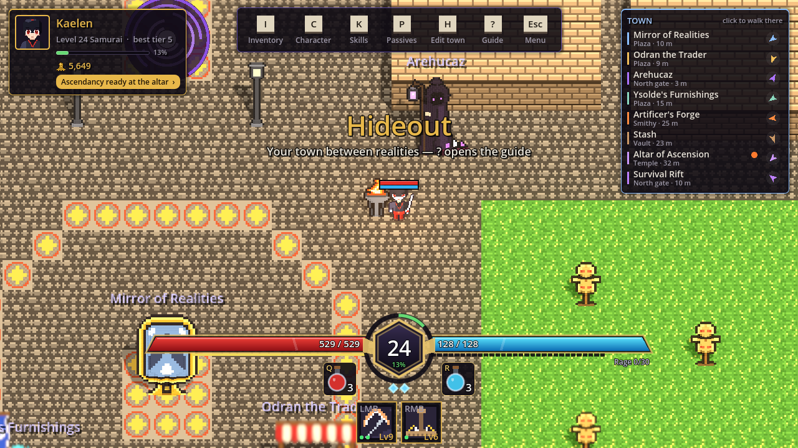
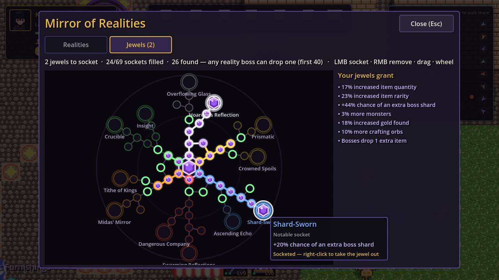

The owner wanted maps that feel joined-up and alive rather than rooms linked by
corridors, and liked cellular automata. Three days of work followed, starting
with a long list of feedback from playing the Rift.

## The Rift fights back

Skills in the Survival Rift no longer fire every frame their use time allows;
each has an auto-cast interval (1.5 x use time + cooldown, at least 0.5 s),
shortened by cast speed and a new card. Difficulty now hangs off a **danger
level** that rises every minute: enemy life and damage compound (x5.5 life at
7:00, x16 at 15:00), spawn rate and the alive cap climb, and elites start mixing
into ordinary spawns. Killing the Colossus no longer ends the run: a portal
opens and the **endless phase** starts, with bosses every two minutes and a
reward that keeps growing. Two rare power-ups: the Cataclysm (everything on
screen dies) and the Lodestone (every gem on the map flies to you). A bug the
captures caught: the portal opened under the player, who left without choosing.
It now arms only once you step away. Details in [run](https://github.com/AlvaroFalcon/arpg_game/blob/main/docs/design/run.md).

## Caverns

Pure cellular automata gives either scattered caves or a blob, so ours is
*steered*: a winding path from entrance to boss is drawn first, cells are seeded
open by their distance to it (with a noise-wobbled radius, only *mostly* open
inside so rock outcrops and loops survive), and five smoothing passes do the
rest. Then the path is re-carved, a round boss arena is cut behind a wall ring
with one opening, unreachable bits are filled and one-cell pinches widened.
Three styles: the Ashen Depths (lava rivers), the Bone Warrens (narrow, climbing
pillars, ooze pools) and the Drowned Grotto (lagoons and causeways). The room
layouts are kept; the tutorial still uses one.

A 60-seed sweep per style caught three real problems: an arena cut off by its
own wall ring, one-cell hairlines left by a gap-widening pass that chained
through cells it had just opened, and lagoon maps with too little floor for
twelve spaced packs.

The owner then didn't want the map visible before entering, so the per-shard
seed and preview are gone: every entry rolls a new cavern behind a loading
screen. And "the lava and water are squares": the shoreline now comes from a
blurred mask of the liquid tiles cut at one half in the shader, so banks curve.
Two cheaper attempts (rounding from neighbours, per-tile marching squares) still
showed the map's two-tile steps.

### Walls as one rock

The cavern walls never joined up: each wall cell was a brick block with its own
random height, so curves, the boss ring above all, were staircases of cubes.
Caverns now get one rock mesh. Marching squares over cell centres keeps
straight walls on the cell edge (where the collision is) while cutting convex
corners on the diagonal. Heights come from a continuous noise field, so
neighbours share edges, and a world-space shader uses each theme's palette.
Filling every non-floor cell with rock also removed the black pits.

## Spawning: fields, budgets and a director

After researching spawn techniques, the owner picked the recommended mix.
**Realities** place pack spots by Poisson-disk sampling, kept with a chance from
a noise density field (chambers hotter than passages), with quotas per
walking-distance zone. Each pack spends a budget (tier x heat x zone x modifiers)
on monsters by cost, six noise "territories" give regions a resident species,
and members stand on a golden-angle spiral. The **Rift** has a director:
intensity waves from 1D noise, a breather when the player is hurt, a cost
budget, spawns on the edges of the real view rectangle (never on screen) and a
leash for stragglers. A first wave field with two octaves crossed its mean 50
times in 15 minutes, which is jitter, not waves; one octave at lower frequency
gave 25 crossings.

## Cascade drops

The owner approved the cascade from a GitHub issue: item rarity now rolls from
the rarest tier *down*, each tier with its own chance, a hit stops, Common is the
fallback, with one table per source in a single file (the old formula existed in
three copies). Every rarity bonus is one multiplier on every tier, capped at
95 %. Worth watching: a x2 bonus pushes Magic to its cap and Commons nearly
disappear. See [items](https://github.com/AlvaroFalcon/arpg_game/blob/main/docs/design/items.md).

Also that day: **Arehucaz**, a hooded dealer who sells shards of tiers you have
cleared, and the Mirror's **jewel tree** of 70 sockets (quantity, rarity,
shards, density, gold, crafting), whose jewels drop from bosses and can move
freely as long as the tree stays connected.

