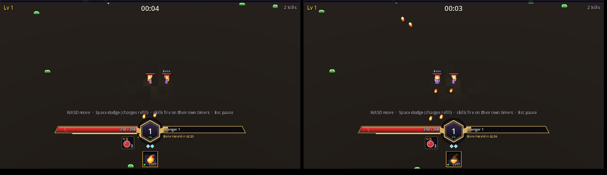
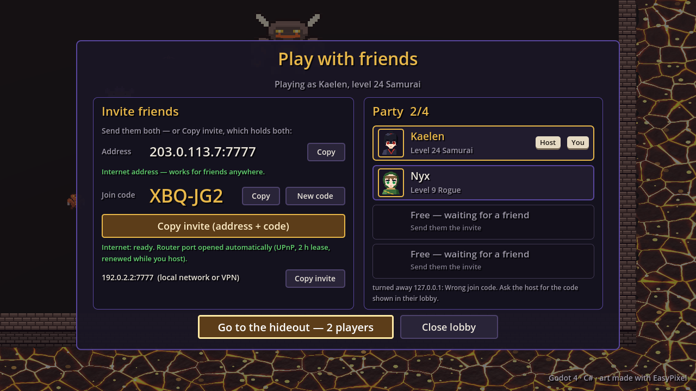
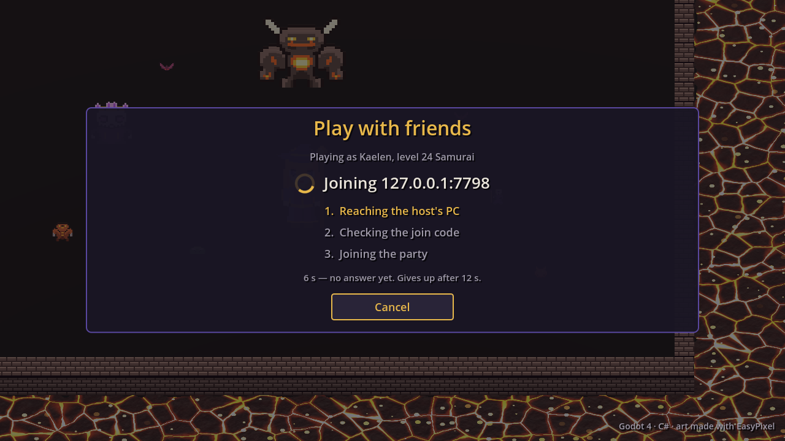
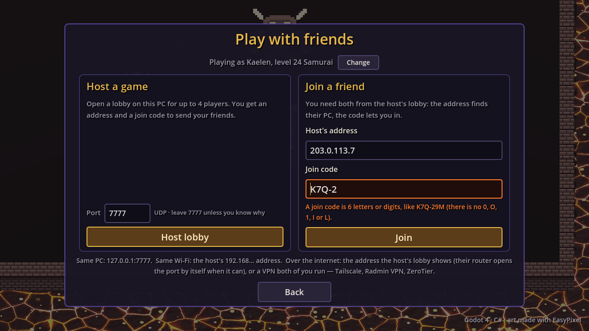
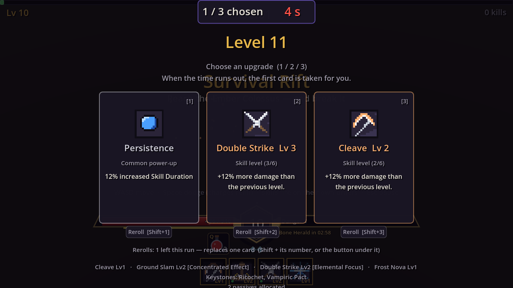

Friends can now play the Survival Rift together. This post follows the feature
over four days, including the review in which we attacked our own code. The full
design is in [multiplayer](https://github.com/AlvaroFalcon/arpg_game/blob/main/docs/design/multiplayer.md).

## The model

One player hosts and up to three join. Everyone brings their own saved character
and keeps their own loot. The host runs the game as if offline; a watcher sends
each client 20 Hz quantised snapshots (players, plus the monsters near that
player) and, once per physics frame, a batch of events: monsters appearing and
dying, projectiles, telegraphs and swings to replay locally, that player's own
drops, level-ups and gear. Clients predict their own movement and reconcile
against the host, and draw everything else 100 ms in the past. **Loot is
instanced**: every kill rolls drops for every player and each client sees only
its own. A fallen player is downed until an ally stands next to them for 3 s.

Two bugs only showed up in the real two-process test (a host and two client
processes on localhost):

- Godot 4.1.1 sends any RPC on a transfer channel above 0 *unreliably*, whatever
  its mode says, so "reliable" messages vanished under load. Everything is on
  channel 0 now.
- Client reconciliation applied the same error twice when two snapshots
  acknowledged the same input, and the player flew off to -48 billion.

Measured with four players at a late wave: about 40 KB/s per client and under 1
ms of host CPU. The first party scaling table doubled the monster count and the
host's physics with it, so the enemy cap grows slowly and the extra pressure
comes from monster life.

## Without a VPN

The owner wanted friends to join without installing a VPN, and safely. Hosting
now asks the router to open UDP 7777 by UPnP, with a 2 h lease renewed while
hosting and removed on Leave, at the end of a run and on quit. When the router
refuses (no UPnP, or CG-NAT), the lobby says so in plain words. Router calls
run on a single background worker so a slow discovery never freezes the menu.

Every lobby has a **6-character join code** (no look-alike characters) that
travels in Godot's authentication step, so the engine drops everything else a
peer sends until the code is accepted. Five wrong codes in a minute and that
address is ignored for a minute. The host also caps every client message, gives
each peer a message budget and sanity-checks the character it receives.
Two engine details: in 4.1.1, `complete_auth` sends its confirmation to
whichever peer was targeted last, and ENet's plain disconnect throws away the
outgoing queue so a refusal reason never arrives (refusals use
`peer_disconnect_later`).

## Attacking our own host

A new suite plays the stranger, the broken friend and the hostile host, with raw
ENet peers that speak no Godot protocol and a second Godot process as the victim.

**The worst finding wasn't on the network side.** `Profile.Save` opened (and so
emptied) the save file *before* serialising, and .NET's JSON writer throws on NaN
or infinity. A host sending an infinite run clock made the client's best time
infinite, and the save at the end of the run left an empty file: every
character, the stash, the orbs, gone. Saving now serialises first, refuses to
write on failure and replaces the file atomically; the client clamps every
number a host sends. A finite but absurd clock would otherwise have rolled a
hundred million reward orbs and hung the game.

On the host side, slots were the weak point: ENet had exactly three client slots,
so three strangers holding code-less connections locked every friend out. Now
there are 32 slots, the party size is enforced by the lobby, at most 4
connections per address wait for a code, the wait is 5 s, and the failure limiter
keys IPv6 by /64 with a global ceiling. Accepted and documented: the engine
reassembles even a stranger's auth packet before our size check, and a host can
still give a friend rewards within sane bounds.

## "He pressed Connect and nothing happened"

The owner tried it with a friend. Walking the screen as a first-time joiner
found it: without a character, Join was silently disabled; a dead address hid
the form behind "Connecting..." for ENet's ~30 s with no progress or cancel; and
the address field was prefilled with `127.0.0.1:7777`. The redesign shows one
state at a time: pick *Host* or *Join*; the host lobby shows the address and
code in big type, a **Copy invite** button, the router state and **four party
slots**; joining shows a spinner, the step, seconds elapsed and Cancel, and gives
up after 12 s with the real cause (couldn't reach the host, wrong code, party
full, run already started, different versions). Before:

After:

A follow-up: when UPnP failed, the big address was the PC's LAN address. The
fallback now says "Local network only" in orange and offers a *Find my public
IP* button, which only contacts an outside service when pressed.

## One bar, everyone stops, everyone picks

The level-up flow needed its own design. Everyone's gems fill **one party bar**
needing the solo amount x party size (otherwise four players would level four
times as fast and pause four times as often). A level is a *round*: the host
pauses its tree, every client pauses on receipt, and the network nodes keep
running through the pause. Each player gets their own row, rolled locally; a
client's pick isn't applied until the host validates it and answers, so a pick
and the timer crossing on the wire can't leave two copies of a build
disagreeing. A "1 / 3 chosen" counter and a 10 s countdown (red at 5 s) run on
the host's clock; at the deadline the host takes the first card of each missing
player's row. After a round everyone gets 1 s of invulnerability over a 3-2-1.

Tests grew from 43 to 68 checks. A good catch: the passive card key has four
parts, the first validator rejected it, and a rogue's rows were refused with the
timer picking for them.

Death rules, after the owner's answers: solo ends the run with the reward
reached; in co-op a downed player gets back up alone after **10 s** at half
life, or sooner at 40 % if an ally stands by for 3 s. The run ends only when
everyone is down at once. The Colossus cash-out becomes a 15 s party vote where
silence counts as leave.
