The owner asked for loot-game crafting ("invent something, we'll improve it
tomorrow"), a merchant, disenchanting into materials and forging a piece with a
chosen stat. The next day the hideout stopped being a room. Design lives in
[crafting](https://github.com/AlvaroFalcon/arpg_game/blob/main/docs/design/crafting.md) and [hideout](https://github.com/AlvaroFalcon/arpg_game/blob/main/docs/design/hideout.md).

## Nine orbs, a trader and a forge

The first pass was nine original orbs that each map onto a classic crafting
action: Kindling Shard (transmute-like), Flux (reroll), Graft (add a
modifier), Crown (magic to rare), Tempest (reroll a rare), Ascendant (add to a
rare), Sundering (remove), Ash (strip) and Tuning (reroll values). They drop
from monsters and bosses as **wallet counters**, not grid items, so they don't
fight you for inventory space.

The hideout gained **Odran the Trader**: right-click to sell, a buyback shelf
so misclicks are free, and cheap shards for gold. And the **Artificer's
Bench**: pick up an orb and click an item (Shift keeps it in hand, valid targets
light up), disenchant gear into grey, azure, gilded or prismatic dust, or forge
a new item from a base and a modifier of your choice. The chosen modifier is
marked *crafted*, and better dust buys a better tier and a rare result.

The tooltip was reorganised: no tiers by default, **Alt** shows tier, pool and
range in small dim text, and the comparison with your gear moved into its own
panel. The panel got an opaque background after the first capture showed the
merchant's title showing through the translucent one. That capture also caught a
tooltip outliving its grid when the bench switched tabs.

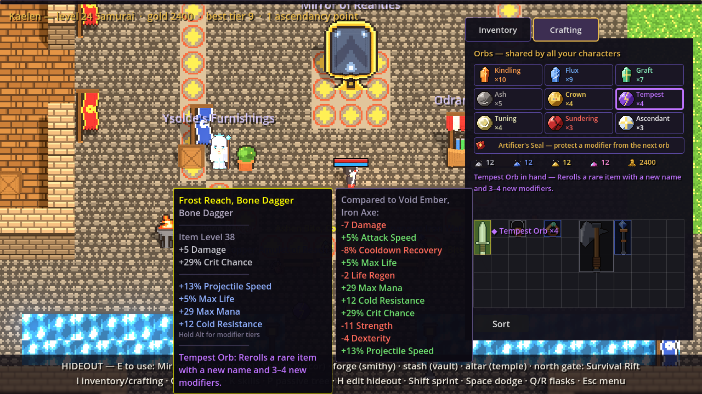

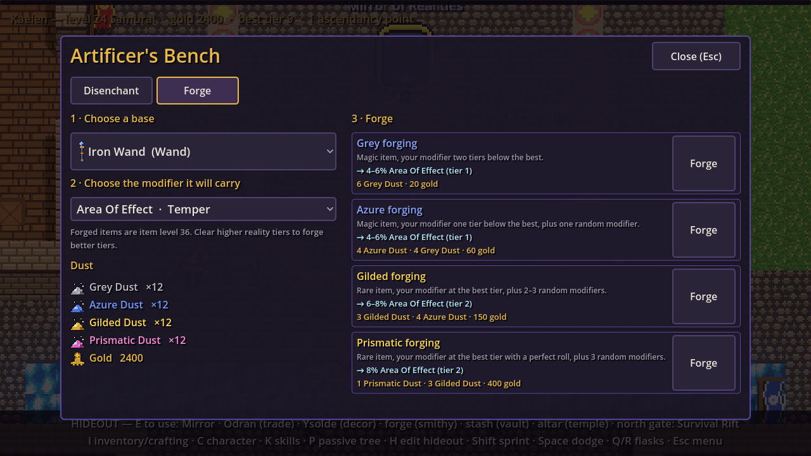

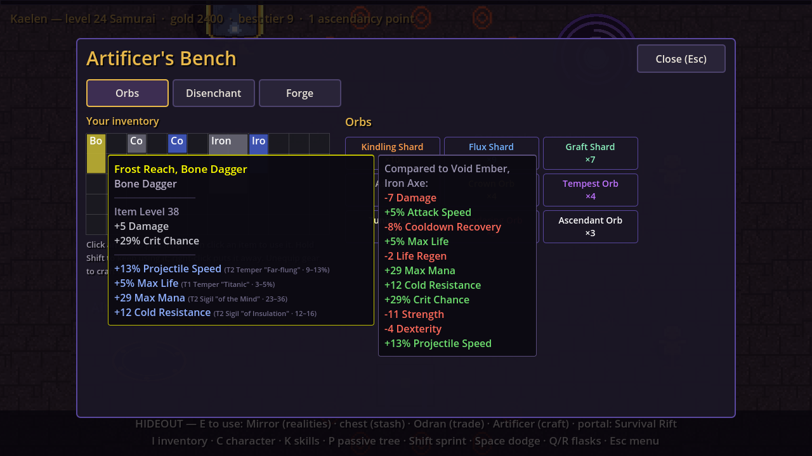

Later that day orbs moved into a Crafting tab of the inventory (I), and the
owner's idea of "lock one modifier, more expensive every time on the same item"
became the **Artificer's Seal**: it protects one modifier from the next orb and
then breaks, for 40 gold doubling per seal on that item, plus dust.

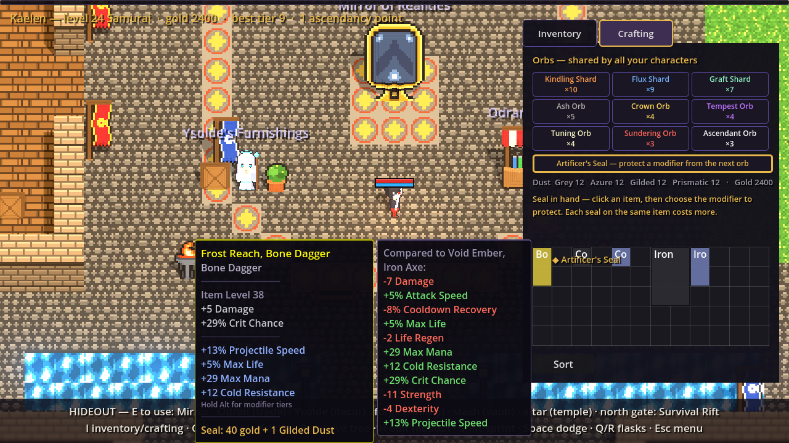

## Items finally look like items

Items were still coloured boxes with a name. Every base now has a pixel-art icon
drawn at 16 px per inventory cell, so an axe fills its 2x3 footprint at 2x
scale. Crafting currencies got 16x16 icons too. The first capture showed grid
icons at 1x: the cell rect is shrunk by a pixel for the border, which floored
the 2x scale to 1x. A test now fails if a new base comes without art.

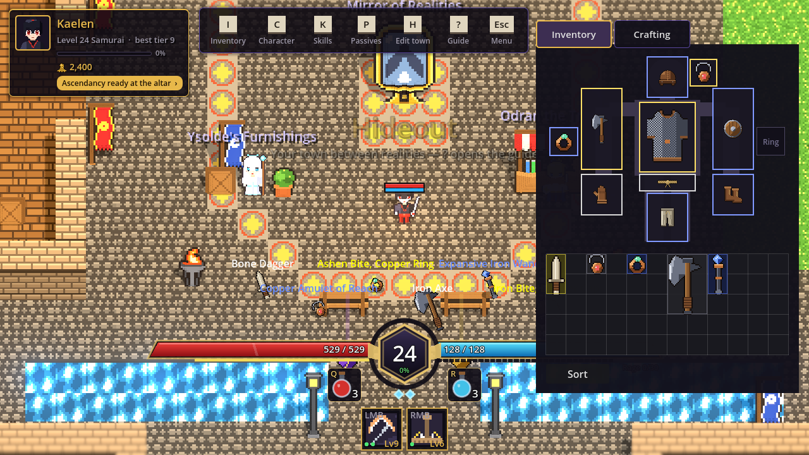

## A city instead of an empty room

The owner wanted a city: the Mirror and the merchant on a central plaza, the
forge in a smithy, an edit mode to move things around and a shop for floor
tiles and decorations. The hideout is now a walled 50x36-cell town drawn as a
text map: a mosaic plaza with the Mirror, Odran's stall and Ysolde's
Furnishings; a smithy; a training yard; the Survival Rift at the north gate;
and across a canal with three bridges, a marble temple with the altar, a garden
with a well and a carpeted vault for the stash. A new tileset and sixteen props
all go through the voxel pipeline.

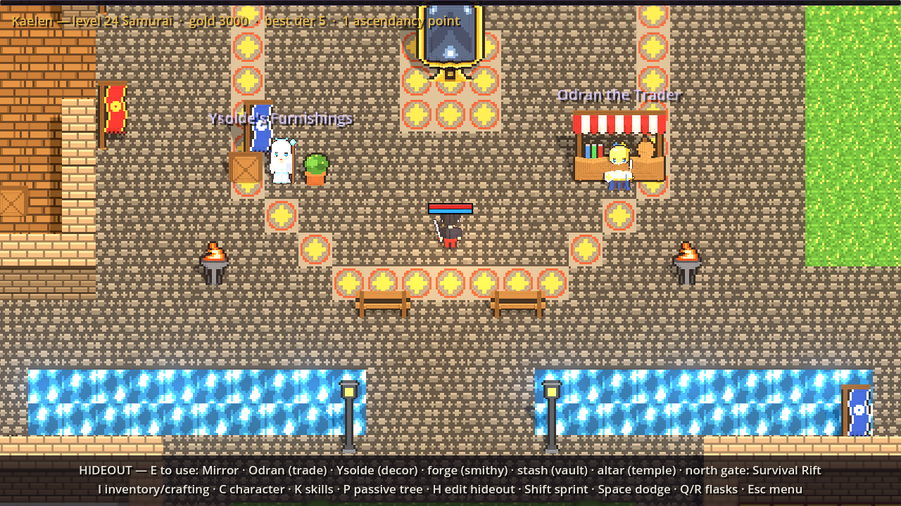

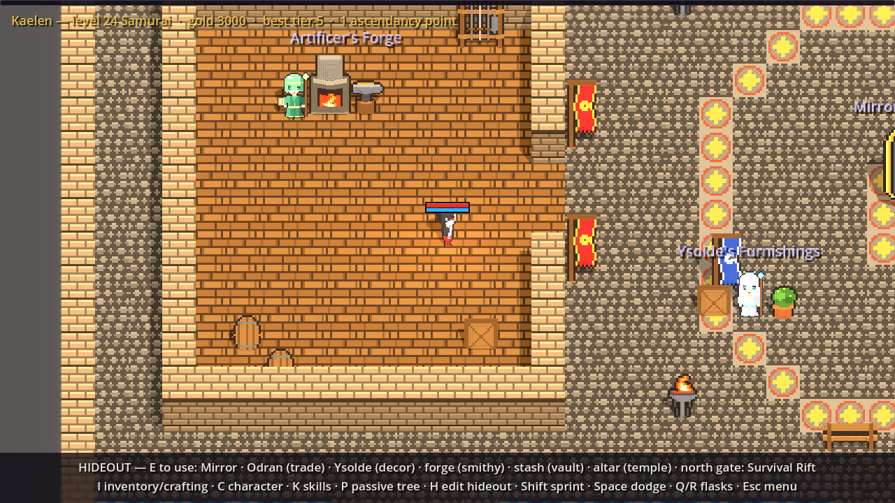

Everything standing in town is a prop the player can drag around in edit mode
(H), stations included. Decorations can be stored, bought floor tiles are
painted cell by cell (right button refunds), and painted cells rebuild their
voxel terrain once painting pauses. The layout, orbs and dust are
**account-wide**. One capture first looked like the edit gizmo wasn't drawing;
it was, under the top bar and too faint, so footprints are bolder now.

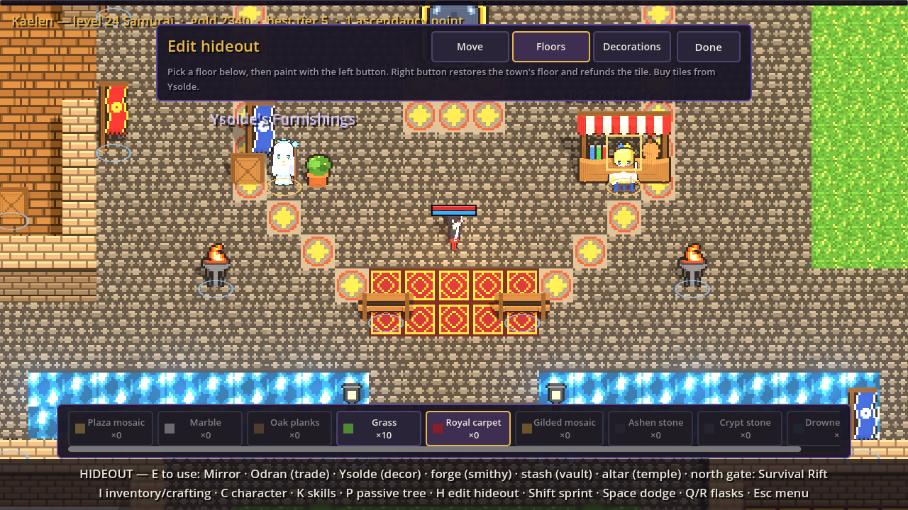

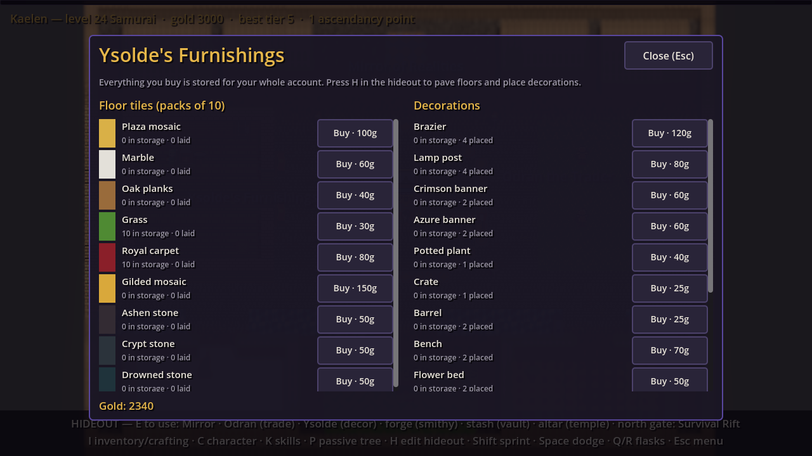

## A HUD that explains itself

The old hideout explanations were a status line, a two-line wall of key hints
and a bare "[E] Mirror". They became a character plate, a menu bar of key caps
that are also buttons, a **town directory** listing every station with its
quarter, distance and an arrow (click to walk there), an E card floating over
the station you stand next to, and a first-visit guide with a "Show me" button
per station. The inventory also learned manners: it sits above every HUD layer,
and panels in its way slide aside or fade. The first slide used a lerp that
never quite reached zero, which a test waiting for the panels to return caught;
it now moves at constant speed and lands exactly.

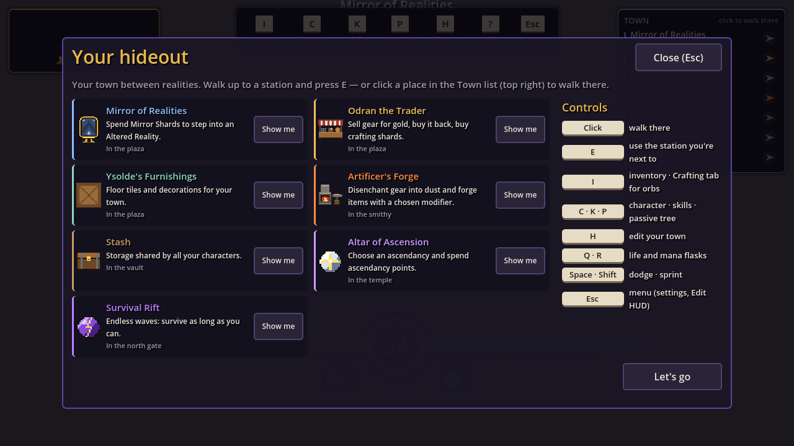

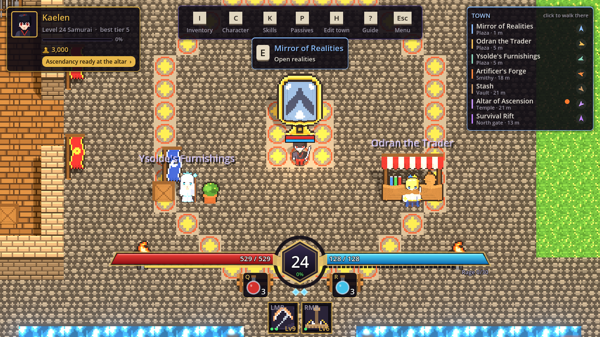

One small headless lesson: physics frames outnumber process frames there, so a
HUD updated in `_Process` needs the test to wait on `ProcessFrame`.

Finally, Esc, Send feedback opens the project's GitHub new-issue page with the
matching issue form filled in. Creating issues straight from the client was
ruled out: it would mean shipping a GitHub token anyone could extract from the
build.
