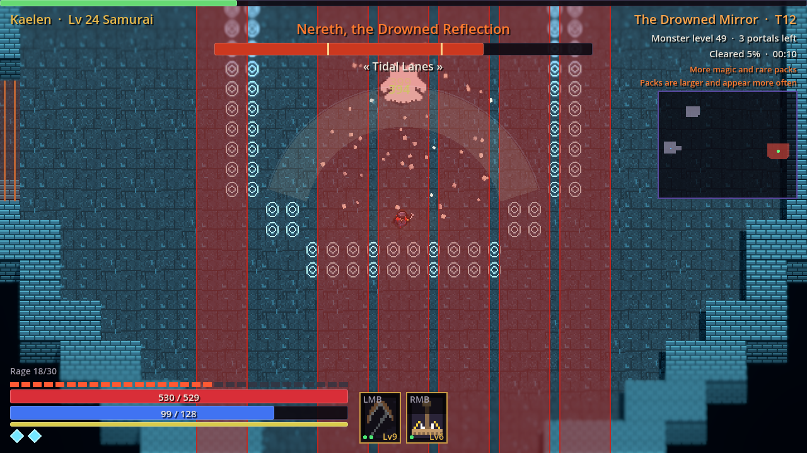
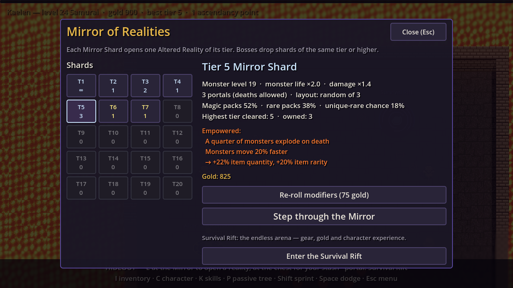
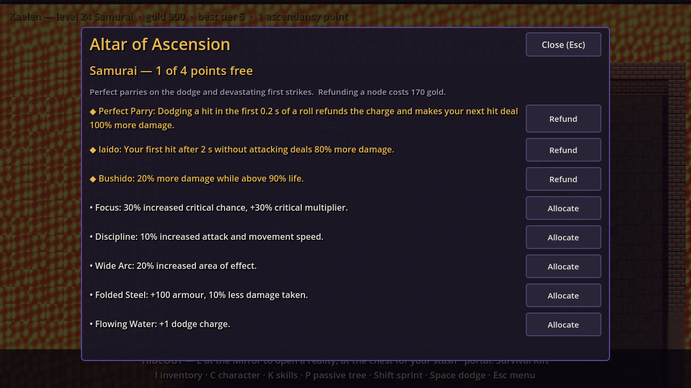
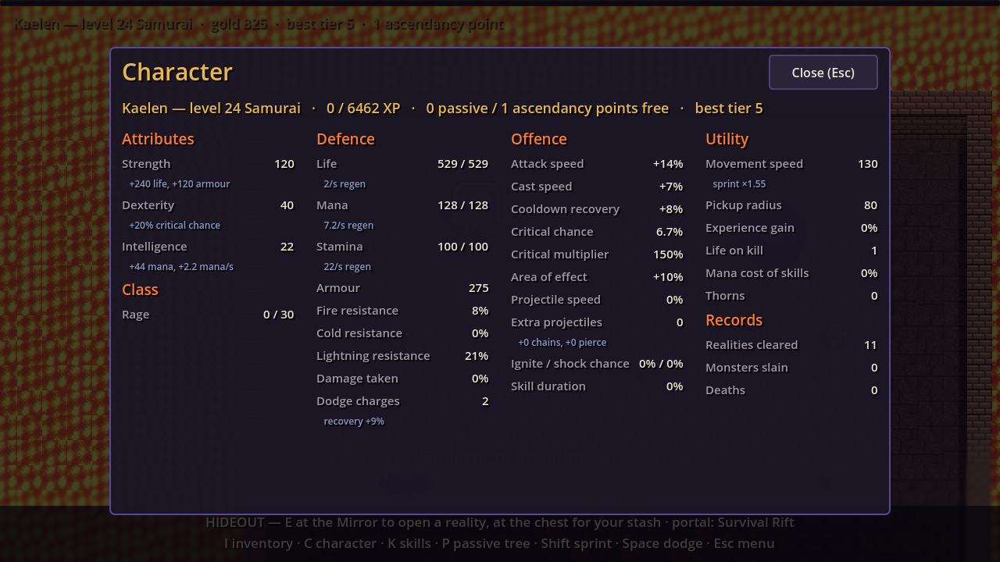
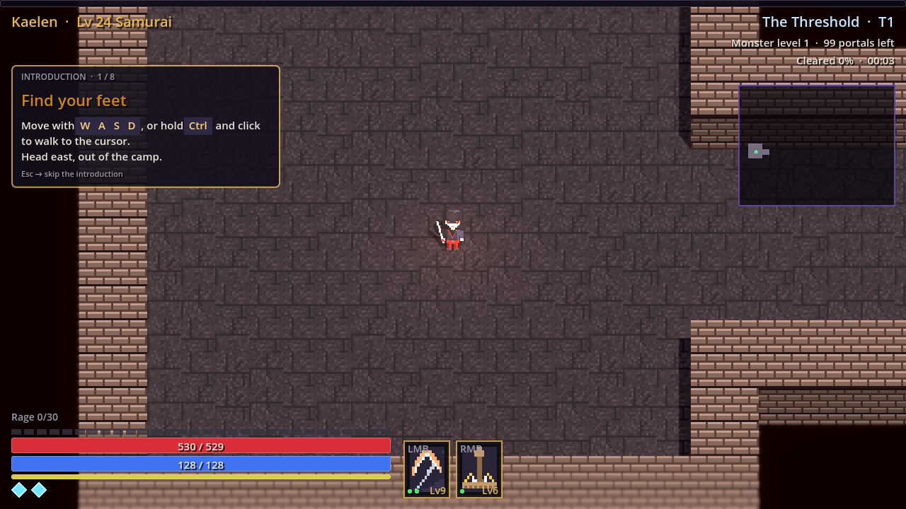

Right after the survivor run came together, the owner changed the direction of
the whole game. The core loop would be the **map endgame** of the loot-driven
ARPGs the author has played for years: no campaign, just a hideout, a Mirror,
and shards that open harder and harder levels. This post covers the pivot, the
night when all six planned milestones landed, and the first round of feedback
after the owner actually played it.

## The pivot, on paper first

The brief was simple: *Mirror Shards* (tiers 1 to 20) open **Altered
Realities**: layouts with randomised details, full of normal, magic and rare
packs and the odd purple "unique-rare" mini-boss, always ending in a boss that
drops loot and more shards. Three base classes: Warrior (becoming Barbarian,
Paladin or Samurai), a Dex starter proposed as Rogue (Assassin, Ninja), and a
mage proposed as Arcanist (Ascendant, Warlock, Sage).

Nothing was coded at first. The structure, proposed numbers and the open
questions went into [endgame](https://github.com/AlvaroFalcon/arpg_game/blob/main/docs/design/endgame.md) and
[classes](https://github.com/AlvaroFalcon/arpg_game/blob/main/docs/design/classes.md). The main question was whether character level and
build should become persistent (recommended) instead of the survivor run's
per-run cards. The owner said "go ahead with all of them", and the
recommendations became decisions: three portals (the third from tier 15), a
persistent character with a shared tree and gems, the Survival Rift kept as a
mode, violet unique-rares, tier 1 always free, gold respecs.

## Six milestones, one night

- **Layouts are room graphs, not ASCII.** The first layout was drawn as a text
  grid like our sprites, and it came out disconnected in two places. Rooms at
  fixed positions with corridors between them are connected by construction and
  still recognisable places; packs, pillars and pools land randomly inside. A
  test rasterises every layout with 40 seeds and checks by BFS that the boss and
  every pack are reachable.
- **A flow field instead of the NavigationServer.** One BFS from the player
  every 0.25 s; each monster steps toward the lower neighbour. It cannot fail to
  find a path that exists, costs one search for the whole map, makes the boss
  gate just "these cells are unwalkable", and avoids the NavigationServer's
  shutdown hang.
- **Persistent characters.** Up to six per profile, level 1 to 70, a 92-node
  passive tree with three class starts, and skills and supports as gems in a
  loadout. Skill gems level with their kills; duplicate drops melt into gem XP.
- **Classes and ascendancies.** Melee arrived, with Combo, Rage and Arcane
  Charges as class resources. Eight ascendancies of eight nodes each, chosen at
  an altar after the tier-5 boss; their behaviour nodes hook into a damage-hook
  registry.
- **Content.** New tilesets for the Bone Crypt and the Drowned Mirror, three new
  monsters, and Nereth, the Drowned Reflection: tidal lanes with a gap, a
  whirlpool whose eye erupts, mirror images firing lane crosses, and Rising
  Tide, our first *inverse* telegraph, where everything floods except three lit
  circles.

### The test that "hung" was the game working

`EndgameSmokeTest` froze right after killing the boss: low CPU, idle main
loop, no exception. The exit portal spawns under the boss, and the test had
parked the player right there, so the reality *finished* and changed scene to
the hideout, freeing the test node mid-await. We also learned that
`_ = RunAll()` swallows exceptions; the test now wraps itself in try/catch and
mirrors every line to a file that the runner reads, because stdout is
block-buffered when it isn't a terminal.

### What the bot found

The autoplay bot got a reality mode and reported three things worth fixing:
Colossus and Nereth fights took 6 to 8 minutes against about 2 for the Herald
(boss life was evened out); melee starters did a quarter to half of the mage's
damage at much more risk (melee skills buffed by about 65 %); and auto-aim
happily shot monsters behind walls, or the sleeping boss behind its gate, so it
now needs grid line of sight in realities. After that the Warrior cleared 6 of 6
runs up to tier 7, the Rogue 4 of 6 up to tier 5, and the Arcanist reached
roughly tier 9 to 13 before gear would be needed.

## First feedback from a real player

The owner played the Windows build and left a list. The ones worth telling:

- **The passive tree tooltip** used to grow a label under the tree and resize the
  whole panel; nodes now get a floating, clamped tooltip.
- **Tooltips through a closed inventory.** The grid polled `Visible`, which is
  its own flag and stays true while a parent is hidden. `IsVisibleInTree()`
  fixed it.
- **Whole numbers.** Rolls whose range reaches 1 now roll integers.
- **Bindings.** Six loadout slots bound to LMB, RMB and 1 to 4; an empty LMB
  keeps click-to-move. The Rift auto-casts everything and has no mana.
- **A paper doll and an account-wide stash** in a chest in the hideout, with
  tabs that cost 150 gold and double.

## The Threshold

New characters used to appear in the hideout with no idea what to do. They now
start in **The Threshold**, an introduction reality that reuses the real
controller in a tutorial mode: fixed small packs, softer monsters, a guide
panel that only advances when you've done the thing (move, dodge, kill the
yard's pack, pick up and equip a gifted item, clear the cache, kill the
guardian, go home). Existing characters skip it, because a missing flag in the
save means "done". Details in [tutorial](https://github.com/AlvaroFalcon/arpg_game/blob/main/docs/design/tutorial.md).

## Honest leftovers

At this point no human had balanced anything: every number came from a bot that
dodges well and never equips gear, so tier 10+ numbers were a floor. There were
no boss-specific uniques, and melee skills ignored weapon type. The next post is
about the look of the thing, because the owner had opinions.
