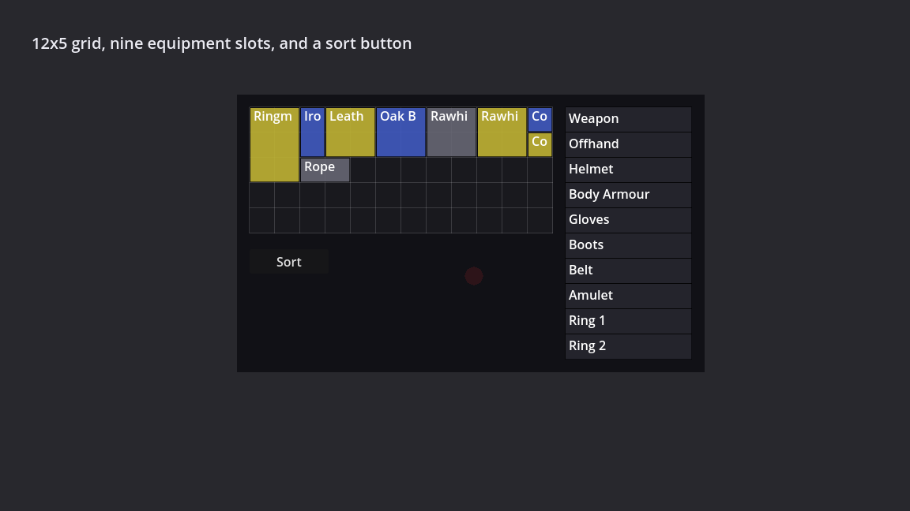
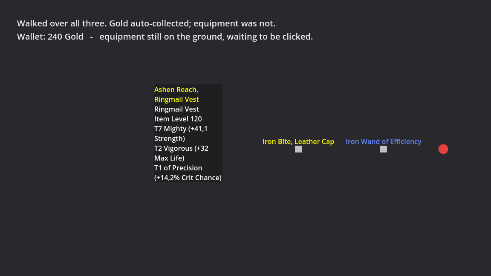
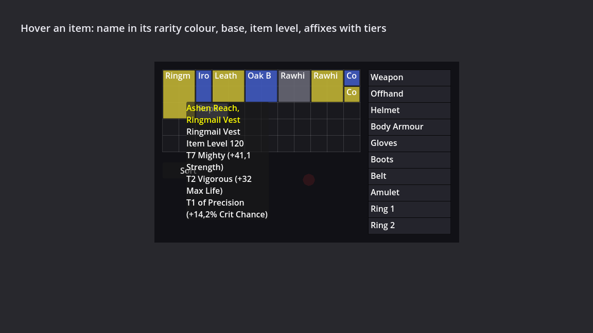

The [last post](../affixes-and-equipping/) ended with equipping working
but no screen to do it from — auto-equip-on-pickup, a bridge explicitly labelled
as scaffolding, standing in for the grid inventory that didn't exist yet. This
post is that grid, plus the nine-slot equipment strip beside it, and then — the
part that ended up being most of the work — six bugs that a 34-assertion test
suite had no way to see, because it was checking the right thing about the wrong
layer.

## The grid, and the trick it's built on

`docs/design/items.md` picked up an "Inventory interaction" section before any
of this was code: a 12x5 grid, 60 cells, sized to match PoE's — big enough that
you're not nagged between packs, small enough that clearing it out is a real
decision instead of a chore. Toggled with `i`, and the world keeps running
behind it — this is an ARPG, not a menu game, and a pausing inventory encourages
sorting mid-fight instead of before or after it.



The equipment strip shipped in the same milestone rather than being deferred,
and the reason is almost embarrassingly simple in hindsight: milestone 2b could
equip an item but never take it off. An inventory that only equips makes
swapping gear one-way. Shipping the grid without somewhere to drag an item back
*out* of would have been shipping something the player couldn't actually use —
half a loop dressed up as the whole thing. It's deliberately not a paper-doll
figure; that's art scope the strip doesn't need to pay for to convey the same
information — nine labelled rows, one per slot.

The part of `Inventory` worth showing is the seam the design doc calls "the
whole trick":

```csharp
public static class ItemShape
{
    // A width x height mask, indexed [x, y], with every cell occupied.
    public static bool[,] MaskFor(int width, int height) { /* ... */ }
}
```

Every placement, collision, and free-space check in `Inventory` reasons about
this boolean mask, never about a rectangle directly. Every item shipping today
*is* a rectangle, so today this buys exactly nothing — `MaskFor` always returns
a fully-true grid. The entire point is what it buys later: a non-rectangular
item (should one ever get authored) becomes a different mask generator, and
`Inventory`'s placement code doesn't change at all, because it never learned the
word "rectangle" in the first place. It's the same bet the projectile executor
made back in the skills milestone — author the seam before anything needs it,
because retrofitting it after several call sites have baked in an assumption is
the expensive version of the same change.

The other real design constraint was swap safety. Right-click an item in the
grid and it equips into the first valid free slot, or swaps with whatever's
already there; a displaced item always lands in the exact cell the incoming
item just vacated. That's provably always free and always the right size —
today, because every slot has exactly one authored base item, so displaced and
incoming always share a footprint. Equipping can never equip-and-strand an
item, and unequipping into a full grid fails safely: the item stays equipped,
stats untouched, no phantom entry anywhere.

## "None of them render anything"

A capture tool went to get the first UI screenshot — same shape as the
`DropCapture`/`SkillCapture` tooling from earlier sessions, a windowed run
scripted through a few phases. It found one real bug immediately
(`EquipmentItem` is an `Area2D`, so `new EquipmentItem()` produces a detached
node and `Initialize` throws — items have to come from `EquipmentDrop.tscn` and
be added to the tree first, the same path `OnPickup` already uses). But the
sentence that ended up mattering more than any single bug is the one written
into that commit almost as an aside:

> Every one of `InventorySmokeTest`'s 34 assertions exercises the `Inventory`
> model. A grid that computes placements perfectly and draws nothing would pass
> all of them, so none of them proved the UI renders.

That's not a criticism of the test — every one of those 34 checks is correct
and still passes today. It's a statement about what a test *can* prove. A grid
whose placement math is airtight and whose tooltip has never rendered once are
not in tension with each other; they're both true descriptions of the same
codebase at the same time, because the test suite and the bug lived in
different layers entirely: model correctness on one side, per-frame
interaction and node lifecycle on the other. Nothing in `InventorySmokeTest`
ever asked a `Control` to draw a frame, so nothing in it could have found what
came next.

## Six bugs, found by playing, not by testing

Every one of these was reported from actually clicking around in the running
game. None was caught by a failing assertion — the point isn't that the tests
were bad, it's that they were answering a different question than "does this
work when a person uses it."

**Tooltips never appeared. On the ground, in the grid, anywhere.** Three
independent sources feed one shared `ItemTooltipControl` — the grid, the
equipment strip, and ground-item hover — and the grid and strip poll hover
every single frame. Each one called `Hide()` unconditionally whenever the
cursor wasn't over an item, and whichever ran last in a given frame won. Since
"the cursor is over an item right now" is the rare case, that meant almost
every frame was a miss from at least one source. With the inventory panel
closed, the grid was still running and still hiding the tooltip every frame —
so a ground-item hover couldn't survive a single tick before something else
clobbered it. With the panel open, the grid and the strip simply undid each
other back and forth. The fix is ownership instead of call order:

```csharp
public void Show(EquipmentItem item, object requester)
{
    _owner = requester;
    // ...
}

public void Clear(object requester)
{
    if (!ReferenceEquals(_owner, requester))
    {
        return;
    }

    _owner = null;
    Visible = false;
}
```

A source can only take the tooltip away if it's the one currently holding it.
A fourth hover source showing up later can't silently kill the whole feature
the same way this one did.

**A second, completely independent reason it was still invisible.** Every
`CanvasLayer` in the scene defaults to layer 0, which makes draw order fall
back to tree position — and `ItemTooltipControl` happens to be declared in
`Main.tscn` *before* the `Player` instance that owns the inventory panel. At
layer 0, the panel simply drew straight over the tooltip. `ItemTooltipControl`
now sets `Layer = 100` on itself in `_Ready`, specifically so no future scene
reordering can reintroduce this by accident — the fix lives in the class that
needs the guarantee, not in scene authoring discipline.

**The tooltip survived pickup.** Click an item up and its tooltip stayed on
screen, describing something that was now sitting in the bag. Tooltip release
normally rides on `MouseExited`, and that signal never fires here — the item
is detached from the scene tree in the same frame the click lands, so as far
as Godot's input system is concerned the cursor never "left" it. The fix moved
release into `ReleaseLabel`, the one place both pickup and `_ExitTree` already
funnel through, because the ground label and the tooltip claim are lost for
exactly the same underlying reason.

**Dragging an item in the grid also moved the character underneath it.** A
`Control` with `MouseFilter.Stop` swallows a click before `_UnhandledInput`
ever sees it — but the global `Input` singleton keeps reporting the button
held regardless, because that's a raw hardware snapshot taken before any node
gets a look at the event. `Player`'s path-follow movement was polling
`Input.IsActionPressed` directly, so it had no way to tell "holding LMB over
the world" apart from "dragging an item over the inventory panel." The fix is
`MouseActionGate`: it only *raises* its latch from an event that survives all
the way to `_UnhandledInput` — meaning the GUI genuinely didn't want it — and
only *lowers* it by trusting a raw `Input.IsActionPressed` going false, since a
physical release should always stop whatever was happening regardless of which
node the matching release event landed on.



**Walking over gear picked it up automatically**, and inside two packs a
60-cell grid was full of vendor trash. This is called out in the design doc
explicitly as a design bug rather than a preference: auto-collecting equipment
takes away the entire "is this worth carrying" decision a limited grid exists
to pose. Equipment pickup is click-only now — the ground label or the sprite,
the D2/PoE interaction — and only currency still auto-collects, per its own
`AutoPickup` flag. This is also where manual pickup ran straight into an
existing rule: `docs/design/items.md` has always said filters control display
and never behaviour, so a hidden gold pile still gets auto-collected. But
manual pickup means a filter-hidden *item* has nothing obvious to click, which
puts real pressure on that rule for the first time. The resolution: the
sprite stays clickable even with its label hidden. The two click paths — label
via `GroundLabel.OnClicked`, sprite via `Area2D.InputEvent` — are entirely
independent, so this held without new plumbing. A filter can make loot
quieter. It can never make it unobtainable.

**Items were pickable from clear across the arena.** A click now only
completes a pickup within about 110 pixels — roughly three character widths,
close enough to read as "standing over it." The first version of this simply
refused a click outside that radius, and the commit that introduced it said so
directly: refusing the click was flagged as the weakest part of the decision,
because every ARPG in this lineage walks the character there instead of doing
nothing. That got fixed the same day — an out-of-range click now sets a
pending-pickup intent on the *player*, not the item:

```csharp
public void RequestPickup(Items.EquipmentItem item)
{
    _pendingPickup = item;
    _navigationAgent.TargetPosition = item.GlobalPosition;
}
```

Only one such intent can be outstanding at a time — a second click replaces
the first — and it resolves on proximity rather than "navigation finished,"
since the path's endpoint is the item's exact centre and reach is satisfied
well before the character actually arrives there. Any deliberate movement
(WASD, another click) cancels the pending pickup outright, on the reasoning
that getting yanked back toward an item you'd mentally moved on from is worse
than the original click having silently done nothing.

Two lower-stakes additions rode along in the same session: `Z` toggles all
ground labels (closing out an old `[PROPOSED]` question — a toggle beats a
held key once a screen has enough loot on it to be worth reading), and Left
Alt reveals labels a filter is currently hiding. These answer genuinely
different questions — `Z` is "am I reading the floor right now," Alt is "what
is my filter keeping from me" — and they compose. Alt is specifically the
release valve that makes writing an aggressive filter safe: a filter you can't
see through is one you stop trusting, and that's a much easier promise to keep
when the player can check what got hidden at any moment.

## The tooltip, once it actually showed up



This is what all four tooltip fixes were chasing — name in its rarity colour
(sourced from `FilterChain.Evaluate`, never a direct read of the rarity enum,
same discipline ground labels already follow), base type, item level, and the
rolled affixes with their tier numbers attached. Showing tiers is deliberate
and matches `docs/design/affixes.md`'s own reasoning: PoE hides them, and
its playerbase responded by installing third-party tools to read them anyway.
A grid cell showing a colour and a clipped base name ("Ringm", "Leath") isn't
enough information to make the keep-or-drop call the inventory exists to pose
in the first place — the tooltip is where that decision actually gets made.

## What's still unfinished

Item names truncate in grid cells — a 2x3 slot isn't wide enough for most
generated display names, and there's no fix for that yet beyond the tooltip
existing at all. There's no sort button (`docs/design/items.md`'s milestone
2e, and the natural next thing to build — the occupancy mask exists partly
to make this cheap once it lands). No stash. No tooltip comparison against
whatever's currently equipped in that slot, which is table stakes for actually
deciding whether an upgrade is real. Affix values are still uncalibrated,
because there's no character leveling system yet to calibrate them against —
every number in the affix pool is still assuming a life/mana curve that
doesn't exist. Set bonuses and Majestic effects remain paper-only, exactly
where the last post left them.

## What's next

The sort button is the obvious next step and the cheapest one — the occupancy
mask was built with exactly this in mind. After that, a weighted drop table
with a real `DropContext` (monster level, area level, magic find), so gear
stops arriving from one hardcoded roll call per kill and starts arriving from
something that resembles an actual loot table.
