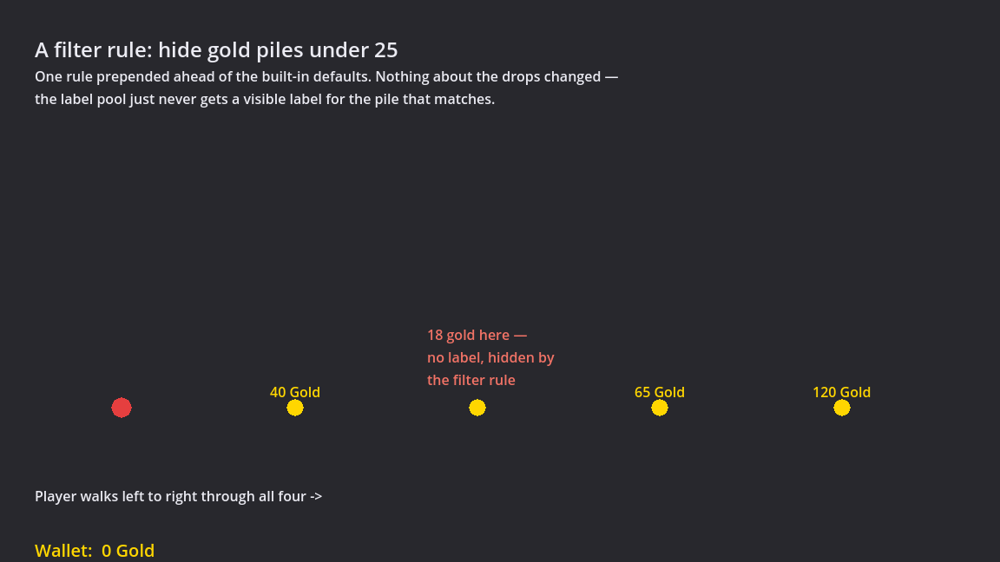
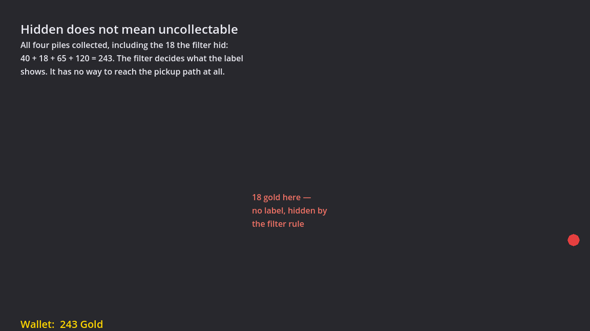
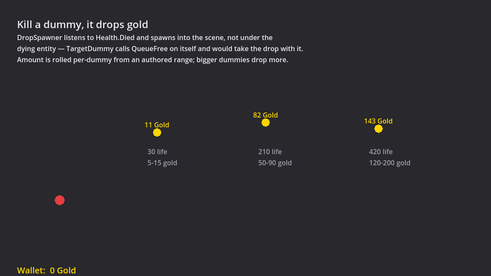

The [last post](../skills-and-combat/) ended with a fireball that
could fork, pierce, and fan into a spread. This one is a step sideways rather
than forward: before a single item can drop, something has to decide what a
"item" even is — and this project decided that question almost entirely
backwards, by designing for a feature that isn't built.

That feature is the in-game item filter — the thing ARPG players live
inside of, the config that recolours, resizes, or hides drops so a screen full
of loot doesn't drown the two things that matter. There's no UI for it yet.
There may not be for a while. But `docs/design/items.md` and the milestone-1
code in `scripts/Items/` were both written entirely in its shadow, because of
one governing rule stated at the top of the design doc:

> A filter can only act on fields it can see. Whatever is not in the
> descriptor at drop time can never be filtered on.

That sentence is the spine of everything below.

## Fixing the vocabulary before there's anything to say with it

If a filter can only see what's in the descriptor, then the descriptor's
shape has to be settled *before* equipment, sets, or majestic items exist to
populate it — because by the time those systems land, every drop that came
before them was already frozen out of half the filter's vocabulary. So
`ItemDescriptor` was written to the full field list the design doc lays out,
not the field list milestone 1 actually needs:

```csharp
public sealed class ItemDescriptor
{
    public ItemClass ItemClass { get; init; }
    public string? BaseTypeId { get; init; }
    public Rarity Rarity { get; init; } = Rarity.Common;
    public int ItemLevel { get; init; }
    public int AreaLevel { get; init; }
    public int AffixCount { get; init; }
    public IReadOnlyList<int> AffixTiers { get; init; } = Array.Empty<int>();
    public int? HighestAffixTier { get; init; }
    public string? SetId { get; init; }
    public string? MajesticEffectId { get; init; }
    public int SocketCount { get; init; }
    public int StackSize { get; init; }
    public int Width { get; init; }
    public int Height { get; init; }
    public string DisplayName { get; init; } = "";
    public CurrencyId? CurrencyId { get; init; }
    public long? Amount { get; init; }
    public ItemTags Tags { get; init; } = ItemTags.None;
}
```

`SetId`, `MajesticEffectId`, `AffixTiers`, `SocketCount` — none of those have
a producer today. No system in the game currently writes a non-default value
into any of them. That's not scaffolding left over from an overambitious
first draft; it's the point. The alternative is adding fields later, one
system at a time, which quietly means every drop that shipped before a given
field existed can never satisfy a filter rule written against it — a
"hide items with T1–T2 affixes" rule the player writes on day one of milestone
2 would be silently unenforceable against milestone-1 drops if `AffixTiers`
hadn't already existed. Settling the vocabulary early is cheap; discovering a
gap in it after players have saved filters against the old one is not.

The `ItemsSmokeTest` checks this mechanically rather than trusting the design
doc's prose — it constructs a descriptor exercising every field, including
the no-producer-yet ones, and asserts each round-trips through the
init-only properties unchanged.

## Rarity colour is filter output, not label state

This is the idea the whole system leans on, and it's worth walking through
because the wrong version is the obvious one to write first.

The obvious version: a `Rarity` enum, and a label node that reads
`rarity.Color` when it draws. It works, it's four lines, and it's a trap.
The moment a player writes a filter rule that says "show Common items in
red, I'm crafting with them," that rule has to fight the label's own
built-in colour logic — either the label special-cases "is there an active
filter" or the filter has to reach into label internals it shouldn't know
about. Either way, "what colour is this text" now has two independent
authorities that can disagree.

So the pipeline goes the other way:

```
Roll item → ItemDescriptor → FilterChain.Evaluate(desc) → DisplayStyle → spawn label
```

Rarity colour isn't a property of the enum at all. It's the *output* of a
filter rule — specifically, of a **built-in default `FilterChain`** that
ships with the game and assigns the standard rarity palette:

```csharp
public static readonly IReadOnlyList<FilterRule> All = new[]
{
    new FilterRule(d => d.CurrencyId is not null, new DisplayStyle { TextColor = CurrencyGold }),
    new FilterRule(d => d.Rarity == Rarity.Common,   new DisplayStyle { TextColor = Colors.White }),
    new FilterRule(d => d.Rarity == Rarity.Magic,    new DisplayStyle { TextColor = MagicBlue }),
    new FilterRule(d => d.Rarity == Rarity.Rare,     new DisplayStyle { TextColor = Colors.Yellow }),
    new FilterRule(d => d.Rarity == Rarity.Majestic, new DisplayStyle { TextColor = MajesticPink }),
    new FilterRule(d => d.Rarity == Rarity.Set,      new DisplayStyle { TextColor = SetOrange }),
};
```

A future player-authored filter doesn't override this list — it **prepends**
to it. First matching rule wins (the usual loot-filter semantics, and `FilterChain.Evaluate`
is the one place that rule is allowed to live), so a user rule ahead of the
defaults simply intercepts before the default ever gets asked. Want Common
items red? Prepend one rule. The label node itself never learns rarity
exists; it just paints whatever `DisplayStyle` it was handed. There is no
special case anywhere in label code — including for currency, which gets its
own default rule (checked *first*, deliberately, since every descriptor
defaults to `Rarity.Common` and a gold pile is technically Common too — if
the rarity rule ran first, a gold pile would render white before ever
reaching its own gold-coloured rule).

`DisplayStyle` itself is a small bag of nullable fields —
`TextColor?`, `BackgroundColor?`, `BorderColor?`, `FontSize?`, `Sound?`,
`Beam?`, `Hidden?` — nullable specifically so a rule can say "I only care
about colour" without accidentally also asserting "and font size should reset
to unset." One field currently has real teeth: `Hidden`. The rest —
`Sound`, `Beam` — are authored and inert, the same "capability set with
nothing wired up" idiom the projectile executor used for fork and chain
before either existed.

## Filters control display, never behaviour

`Hidden` is the interesting field, because it's a genuine trap if you build
it the naive way. Once "hide this from the label" exists as a concept, it's
one careless line away from also meaning "don't collect it" — a filter
implementer folding `Hidden` into the pickup check because it's sitting
right there.

The design doc draws the line explicitly: **a hidden gold pile is still
auto-collected on walk-over.** If hiding something also stopped the player
getting it, filters would silently cost players loot for reasons they can't
see on screen — the exact failure mode the genre's best filters refuse to allow.

`CurrencyDrop`, the milestone-1 `IDroppable` for a gold pile, enforces this
structurally rather than by convention. `OnPickup` takes no `DisplayStyle`
and no `FilterChain` — there's no reference through which either could reach
it:

```csharp
public void OnPickup(Player player)
{
    if (Currency is null || !Currency.AutoPickup) return;
    player.Wallet.Add(Currency.Id, Amount);
    ReleaseLabel();
    QueueFree();
}
```

`ItemsSmokeTest` proves this end to end rather than trusting the method
signature: it prepends a user rule that resolves `Hidden = true` for the
drop sitting in the test scene, confirms the filter genuinely reports it
hidden, and then — through real `Area2D` physics, not a direct method call —
confirms the player's wallet still gets credited and the drop node still
frees itself. Filters are a rendering pass over an already-decided outcome,
never a gate on it.

It's easier to believe when you can see it. Here's a row of four piles with
one user rule prepended ahead of the built-in defaults — *hide gold piles
under 25*. The 18-gold pile is still there, still a real node with a real
descriptor; it just never gets a visible label:



And here is the same row after the player has walked straight through it.
The wallet reads 243 — which is 40 + 18 + 65 + 120, the hidden pile
included:



That pair is the whole rule in two frames: the filter changed what was
drawn and nothing about what happened.

## No unidentified items

Identify scrolls, a genre staple, are absent here, and
that's a deliberate cut rather than an oversight. The reasoning connects
straight back to the filter: an unidentified item's descriptor *changes*
after it drops — the affixes, the tiers, sometimes the rarity, all reveal
themselves later. A mutable descriptor means the filter has to re-evaluate
and restyle the label sometime after the item already exists on the ground,
which is a whole re-evaluation pipeline this project doesn't have and
doesn't want to build. Worse, identify hides from the filter exactly the
fields players most want to filter on — "show me anything with a T1 affix"
can't be answered about an item whose affixes the game itself doesn't know
yet.

Cutting the mechanic doesn't just save code — it removes an entire class of
problem: `ItemDescriptor` is immutable after construction (init-only
properties throughout), full stop. There is nothing in the codebase today
that could mutate one even if it wanted to.

## Currency, built generically because gold is never going to be alone

It would have been faster to hardcode gold: a `long GoldBalance` field on
`Player`, a pickup script that increments it, done. The design doc rejects
that specifically because gold obviously won't stay alone — a crafting
currency is already implied by the Temper/Sigil affix system wanting
"granularity to work with" later. So currency is generic from instance one:

```csharp
[GlobalClass]
public partial class CurrencyDefinition : Resource
{
    [Export] public string Id = "";
    [Export] public string DisplayName = "";
    [Export] public Color Color = Colors.White;
    [Export] public bool AutoPickup = true;
    [Export] public string StackFormat = "{0}";
}
```

`Gold.tres` is just data against this class — `Id = "gold"`,
`StackFormat = "{0} Gold"`. A second currency is a new `.tres` file, not a
new class, not a recompile.

The one field worth calling out is `AutoPickup`, and specifically that it
lives on the *definition*, not as a single global switch somewhere in the
pickup code. A future crafting currency might reasonably want manual pickup,
or routing straight to a stash instead of the player's feet — and if gold's
walk-over collection had been wired directly into the drop's pickup path as
a hardcoded behaviour (rather than gold happening to be a currency with
`AutoPickup = true`), adding that second currency later would mean going
back and un-hardcoding it. Per-currency costs nothing today and avoids a
rewrite whose trigger is entirely predictable.

`CurrencyId` itself is a thin string-backed struct rather than a C# enum,
for the same reason — an enum means every new currency needs a recompile of
the enum type, which directly contradicts "generic from the start."

```csharp
public readonly struct CurrencyId : IEquatable<CurrencyId>
{
    public string Value { get; }
    public static implicit operator CurrencyId(string value) => new(value);
    // ...
}
```

And the wallet is exactly the dictionary the design doc specifies —
`Player.Wallet : Dictionary<CurrencyId, long>` — living on a sibling `Node`
rather than a field bolted onto `Player`, matching how `ActorStats` and
`SkillUser` are already separate components instead of growing `Player` into
a god object. `ItemsSmokeTest` checks silver and gold accumulate
independently in the same wallet, which is the one thing a
single-`long`-field version could never have supported without a rewrite.

## `IDroppable`: narrow on purpose

Currency, equipment, and flask refill orbs are the three drop families in
the design doc, and they're going to share almost everything — the same
drop/spawn path, the same label rendering, the same filter evaluation. They
differ only in what happens on pickup: currency increments a wallet,
equipment goes into a grid inventory, an orb restores flask charges. So the
shared contract is exactly that narrow:

```csharp
public interface IDroppable
{
    ItemDescriptor Descriptor { get; }
    void OnPickup(Player player);
}
```

No inventory reference, no item-slot concept, nothing equipment-shaped
leaking into it. Currency doesn't need a grid position and shouldn't have to
carry one just because equipment will. When equipment lands in milestone 2,
it implements the same two members and gets the same label and filter
treatment for free; `CurrencyDrop` won't need to change at all.

## Milestone 1 shipped currency only — no equipment

The build order in the design doc is explicit that drop pipeline plus
currency comes first, with equipment deliberately deferred to milestone 2.
That's not sequencing for its own sake: currency is the smallest possible
thing that exercises the entire seam — descriptor construction, filter
evaluation, label rendering and pooling, real pickup — without any of
equipment's additional complexity (base items, affix rolling, grid
placement) muddying whether the seam itself is sound. If the pipeline had
been wrong, better to find out with gold piles than with a grid inventory
half-built on top of it.

What did ship: `ItemDescriptor`, `IDroppable`, `Rarity` (five tiers — see the
sidebar below), `ItemClass`, `ItemTags`, `CurrencyDefinition` +
`Gold.tres`, `CurrencyId`, `Wallet`, `FilterChain`/`FilterRule`/
`DisplayStyle`, `BuiltInDefaultRules`, `CurrencyDrop`, and
`GroundLabelPool` — a pooled `CanvasLayer` of `Label` controls that project
from world position to screen every frame and bucket-stack vertically so a
pack's worth of drops don't overlap. Labels are always-on in milestone 1;
hold-key-to-show (the classic convention, versus always-on labels) is flagged
in the design doc as proposed but not yet decided, and the pool's visibility
gate is a single boolean specifically so that switch, whenever it happens,
touches one line instead of every label producer.

Build is clean — 0 errors, 0 warnings — and the new
`scripts/tests/ItemsSmokeTest.cs` passes 10/10 headless: descriptor
round-trip through every field, filter first-match-wins against two
deliberately overlapping rules, an empty chain correctly falling back to
`DisplayStyle.Baseline`, the built-in currency rule resolving ahead of the
rarity rules, per-currency wallet balances tracked independently, and the
hidden-but-still-collected guarantee proven through real `Area2D` physics
rather than a method call in isolation.

### Aside: rarity went from seven tiers to five

Worth a mention even though it's cosmetic compared to everything above. An
earlier pass on the design doc proposed seven rarities, adding Junk/grey and
Uncommon/green to the five listed here. Both got cut on the same test: a
tier only earns its place if the player *does something different* when
they see that colour. Junk and Common both meant "ignore this"; Uncommon and
Magic both meant "one or two affixes, keep moving." Two colours that produce
the same player decision aren't two tiers, they're one tier with a paint
job. Junk can come back if a salvage or crafting sink is ever added to give
it an actual job — without a sink, a tier whose entire purpose is "get
filtered out" isn't pulling its weight.

The more interesting cut was realizing Majestic and Set aren't a ladder —
Set isn't "better than Majestic" or vice versa, they're **siblings**:
Majestic is solo power (one item, one build-defining effect), Set is
commitment power (weak alone, strong at four pieces). An item is never both,
specifically so a four-piece set stacking four majestic effects can't become
the only build worth playing. Neither of those has a producer yet — rarity
above Common needs affix rolling, which is milestone 2 — but the enum and
the filter's rarity rules already exist for all five, for the same
fix-the-vocabulary-early reason `AffixTiers` exists today with nothing
writing to it.

## What's next

A gold pile sitting in a test scene proves the pipeline works; it doesn't
prove anything drops from actually playing. That part landed in the same
session: target dummies now carry a `DropSpawner`, a component node that
listens to `Health.Died` and spawns a pile with an amount rolled from an
authored range. It's a component rather than code inside `TargetDummy`
because a combat entity has no business knowing what a currency is — any
future enemy scene gets drops by adding the node, with no script change.



It is explicitly not the drop table yet — it's a single-entry stand-in so
the pipeline is playable before weighted tables and a `DropContext` are
designed. The one real trap it was built around: `TargetDummy.OnDied` calls
`QueueFree()` on itself, so a drop parented to the dying entity would be
deleted along with it. The spawner adds into the current scene instead, and
a test named `SPAWNED-DROP-OUTLIVES-KILLER` exists to keep it that way.

Building the capture tool for these screenshots also turned up a real bug
that only shows up on screen: labels were positioned starting at the drop's
X, so the pile's own sprite drew over their leading characters and a "115
Gold" pile read as "5 Gold". Labels are centred on the item now. Worth
remembering that a rendering bug can pass ten green tests — none of the
assertions were about pixels.

After that, milestone 2: base items, Temper/Sigil affix rolling with tiers, and the
grid inventory equipment needs to land in — the point at which this
project finds out whether "currency alone proves the seam" was actually
true.
