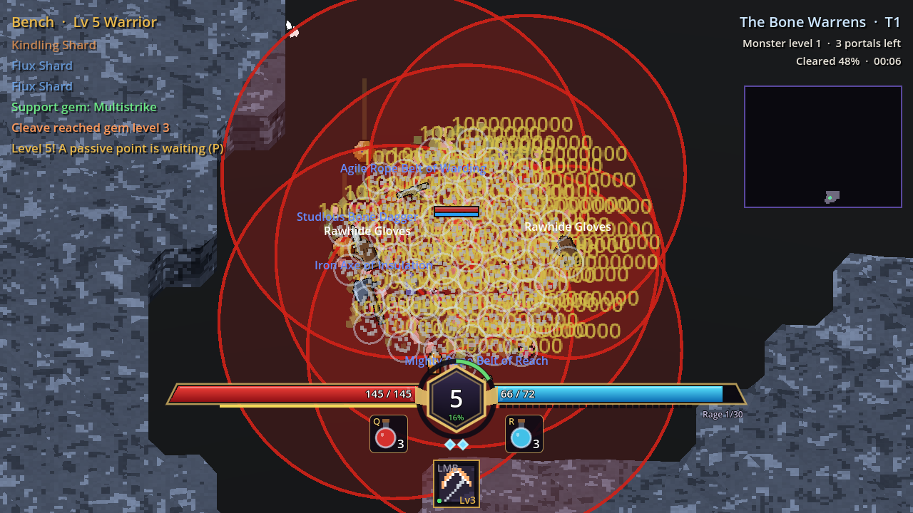
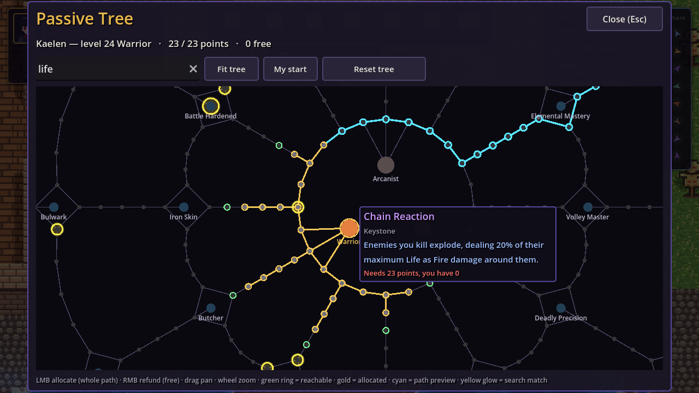

Three problems landed on the same day, and all three were fixed by measuring
first.

## "With little effort I deal too much damage"

The owner's complaint. We measured: against a fresh character, a typical one
out-damaged monster life by x6 at tier 1, x25 at tier 5 and x130 at tier 10. The
biggest single cause was flat "+X damage", which could roll on all eleven gear
slots and was added to a skill's small base (Fireball 22 became about 146 with
a tier-10 set). The general design rule we used after a round of research: whichever curve
grows faster eventually wins.

Three changes:

- **Gear.** Flat added damage only rolls on weapons, rings and the amulet.
  Skills take it at an *added damage effectiveness*: Spark 50 %, Fireball
  100 %, Meteor 150 %.
- **Monster level drives monster stats.** A table holds the expected damage of a
  *reference character* at each monster level, and monster life = time to kill x
  that damage. Targets: normal 0.4 s, magic 1.5 s, rare 5 s, unique 10 s, boss
  45 s. Resistances rise to 30 % at level 85, armour to 15 % of the reference
  hit, and each theme resists its own element.
- **The bot plays the reference character**: gems at the right level, supports,
  ascendancy and a fresh rare set for the tier, logging time to kill per rarity.

The first table, derived from a paper model, was wrong at both ends: too soft at
tier 1 (boss in 19 s) and far too hard from tier 10 (boss 125 s, collapsing at 15
and 20). The model missed that once gems and supports max out around tier 10,
only gear keeps the player's damage growing. After two rescaling passes the
Arcanist sits on target at tiers 5 to 20 (rare 5 to 9 s, boss 39 to 64 s).
Armour surprised us as well: a "25 % against the reference hit" target cost
melee's smaller hits about 40 %, so it dropped to 15 %. The Warrior bot is still
clearly slower than the Arcanist, a class/bot gap we left open.

## The frame drop when exploding packs die

The owner reported a big frame drop when lots of exploding enemies die at once.
Before changing anything we built a benchmark that drops 60 monsters on the
player, kills them in one frame and logs every frame of the next 2.5 seconds.
Headless runs measure the simulation; software-Vulkan runs measure the voxel
view.

The biggest cost was not the explosions but the **voxel crumbles**. Every death
read its model back from the GPU to pick cube colours and made its own
shadow-casting MultiMesh: 124 ms of CPU in the kill call and +183 draw calls.
Cube shapes are now cached per mesh, a frame's crumbles share one MultiMesh and
debris uploads in one call: 18 ms and +4 draws. Damage numbers got pooled, blast
puffs capped at 6 per frame, and a 60-pack's kill frame fell from about 37 to 27
ms headless, with no change in gameplay.

The second pass, with four approved proposals from [performance](https://github.com/AlvaroFalcon/arpg_game/blob/main/docs/design/performance.md):

- Chain Reaction and Decay explosions wait one frame per hop, so a cascade
  *ripples*.
- Volatile blasts land 1.0 s +/- 0.1 s after the death.
- Close blasts draw one merged telegraph per cluster: about 5 outlines for a
  60-pack instead of 60 discs.
- The player takes at most one volatile hit every 0.25 s (before, 60 overlapping
  blasts was 60 hits in one frame, i.e. instant death).
- Drops are rolled on the kill frame but spawn from a queue (2 items or 8
  pickups per frame).

Same-session numbers, 60 Slimes, median of 3: the chain-reaction kill frame
went from 28 to 7 ms and its worst frame from 25 to 16 ms.

## The passive tree grows up

The owner, at level 30, was reaching several branches at once: the old tree had
92 nodes for 69 points. The new one has **339**: an inner ring of attribute and
utility nodes leads out to 24 "wheels", each with four themed small nodes looped
around a notable, with travel nodes between wheels and twelve keystones on the
outer edge. The nearest notable costs about nine points, so at level 30 a
character reaches three or four. Related themes sit near each other but never
together. Six new mechanics came along (life leech, mana on kill, freeze
chance, elemental and physical damage taken) and four keystones.

The panel previews the cheapest path to whatever you hover, with its cost, and
allocates the whole path on click. It also has search, fit/centre buttons and a
free Reset tree; refunds are free while the tree is play-tested, and characters
saved with the old tree silently get their points back.

