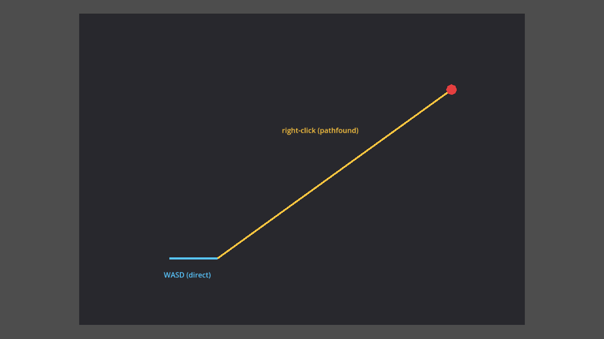
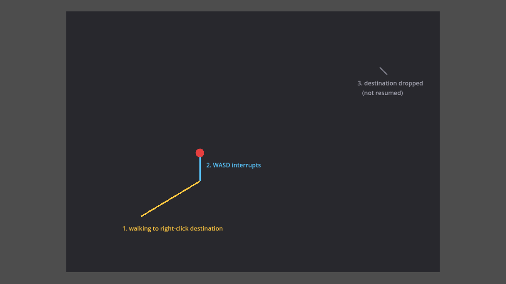

This is the first devlog for ARPG Game, a 2D top-down ARPG in Godot 4.1.1
built in C#/.NET. It's inspired by the loot-driven action RPGs I've sunk far
too many hours into over the years. (If you spot "Path to Exile" on a title
screen in early screenshots: that was a provisional name and an inside joke,
and it's gone now — the game doesn't have an official name yet, so for the
moment it's simply ARPG Game.) Before this session the repo had nothing but scaffolding — a
`CLAUDE.md`, some agent configs, headless-run tooling. No gameplay code at
all. So let's be precise about where "first devlog" actually leaves us:
there is a player character that moves around an empty grey rectangle. That's
it. No combat, no enemies, no art, no level — a placeholder shape sliding
over a placeholder floor. If that sounds like faint progress to open a series
with, the interesting part of this session wasn't the movement code itself.
It was everything that went wrong while trying to see it work.

## What got built

The player supports two ways of moving, sharing one `Velocity` on a
`CharacterBody2D`:

- **WASD**, driving velocity directly every frame, always taking priority.
- **Hold-right-click-to-move**, which retargets a `NavigationAgent2D` to the
  mouse position every physics frame the button is held, then lets the agent
  walk the resulting path to completion — including after the button comes
  up, so a quick click-and-release still reads as "walk over there."

There's no mode enum. `_PhysicsProcess` just checks WASD first each frame;
if it's nonzero, that branch runs and the method returns before touching the
nav agent at all. "Mode" is just whichever branch happened to run.

Movement speed itself isn't a hardcoded float — it comes from a small
stat modifier stack of the kind the genre is built on (more on that below). The full
rationale for both systems, including alternatives considered and rejected
(tile-grid movement, click-then-lock queuing), is written up in
[`docs/design/movement.md`](https://github.com/AlvaroFalcon/arpg_game/blob/main/docs/design/movement.md) and
[`docs/design/stats.md`](https://github.com/AlvaroFalcon/arpg_game/blob/main/docs/design/stats.md) — this post is the narrative
version, not a restatement of the spec.

Here's what it actually looks like, trail color-coded by which branch drove
each frame — blue for WASD, orange for path-follow:



## The two failures that didn't fail loudly

Here's the part worth actually reading. Movement passed every headless
check — clean compile, no script errors, the smoke test asserting positions
all green — while doing precisely nothing when run from the editor. WASD did
nothing. Right-click did nothing. The placeholder shape just sat there.

The instinct at that point is to start doubting the code: is the action
map wrong, is `_PhysicsProcess` even running, is the nav agent misconfigured.
None of that was it. Both problems were environmental, and both failed
completely silently.

**Trap one: the wrong Godot binary.** The project had been opened with the
plain (non-mono) `Godot.app`, not the Mono/.NET build the project actually
needs for C#. The plain build doesn't refuse to open a C# project or throw
an error — it loads it, renders every scene exactly as authored, and simply
never runs a single script. Worse, it quietly **strips the `script =
ExtResource(...)` line out of any scene it re-saves**, because it can't
resolve a C# script type and treats it as attach-nothing. That explained a
mystery from earlier in the session: `Main.tscn` kept losing its script
attachment between sessions, and it had been getting chalked up to editor
staleness and fixed by hand each time. It wasn't staleness. It was the wrong
binary quietly editing the scene file every time it got touched.

**Trap two: PATH, but only for GUI apps.** Immediately after switching to
the correct `Godot_mono.app`, the editor failed outright with `Failed to
load .NET runtime ... hostfxr`. The .NET SDK on this machine lives at
`~/.dotnet`, not the standard location Godot's resolver checks
(`/usr/local/share/dotnet`). That's normally fine from a shell, because the
shell profile puts `~/.dotnet` on `PATH` — but a GUI app launched from
Finder (or Spotlight, or double-click) doesn't inherit a shell's
environment at all. It gets whatever minimal environment macOS hands it,
which doesn't include that `PATH` entry. `scripts/run_headless.sh` had been
masking this the entire time, because it exports `DOTNET_ROOT` and `PATH`
itself before invoking Godot — so every headless check had a correctly
configured environment, and the GUI editor, launched by hand, never did.

Both are now fixed for good rather than patched around: `CLAUDE.md`
documents the trap, and a new `scripts/run_editor.sh` sets the same
environment as the headless script and refuses to launch a non-mono binary,
so the first trap specifically can't happen again by accident.

The lesson underneath both of these, worth keeping somewhere permanent: when
an automated check passes and the real thing in front of you doesn't work,
don't start by doubting the code — check *which binary is actually running*
and *what environment it has*. Two completely different root causes, same
shape of failure: quiet, plausible-looking, nothing-onscreen-to-grep.

## A testing trap with the same shape

Once the environment was actually correct, a related problem showed up one
layer down, in the tests themselves. `scripts/tests/MovementSmokeTest.cs`
drives input programmatically with `Input.ActionPress()` and asserts on the
resulting position — a real functional test, not just "does it compile."
It turns out `Input.ActionPress()` happily works on an action that has
**zero keys bound to it**. The action just needs to exist in the
`InputMap`; nothing checks that a physical key is actually wired to it. So a
movement test can pass with a clean green checkmark while the actual W key
on an actual keyboard does absolutely nothing — the test was only proving
the action name `move_up` existed, not that anything was bound to it. The
test now also asserts on `InputMap.ActionGetEvents()` for each movement
action, so an unbound key fails the test instead of passing it silently.

The same session produced a smaller but sharper version of the same
discipline: after fixing the WASD-cancel bug described below, the fix was
verified by deliberately reverting it and re-running the test — 43.33px of
resumed movement with the bug present, 0.00px with the fix in place. A test
that has never actually been watched to fail on the broken code isn't
evidence that it checks anything. Cheap to do, easy to skip, and skipping it
is exactly how the first two traps went unnoticed for as long as they did.

## Making the interrupt feel right

The last piece was a small but real design decision. The original
implementation just skipped the pathfinding branch while WASD was held — a
minimal-diff way to give WASD priority. But that meant releasing WASD
resumed walking toward whatever right-click destination was still pending,
even though the player had just steered away from it on purpose. In
practice that reads as the character ignoring your correction and finishing
someone else's order instead of yours.

The fix: WASD now cancels the pending destination outright rather than
merely pausing it. Godot 4.1's `NavigationAgent2D` has no direct "cancel
path" method, so the available idiom is retargeting the agent to its own
current position, which the engine then reports as navigation finished:

```csharp
Vector2 wasdDir = Input.GetVector("move_left", "move_right", "move_up", "move_down");
if (wasdDir != Vector2.Zero)
{
    // WASD cancels a pending click-to-move destination outright instead of
    // pausing it — otherwise releasing WASD would resume walking to a target
    // the player has already steered away from.
    if (!_navigationAgent.IsNavigationFinished())
    {
        _navigationAgent.TargetPosition = GlobalPosition;
    }

    Velocity = wasdDir * speed;
    MoveAndSlide();
    return;
}
```

The `IsNavigationFinished()` guard matters: without it, this would retarget
the agent to itself every single physics frame WASD is held, forcing a
repath for no reason. With it, the cancel fires exactly once, on the frame
the interrupt happens.

Here's the three-step version: walking to a right-click destination, WASD
interrupting mid-path, and the destination getting dropped rather than
resumed once WASD releases.



## Speed is a stat, not a number

The other piece of infrastructure this session is easy to miss because it's
currently backing exactly one number: `PlayerStats.MovementSpeed` isn't a
constant, it's a `Stat` — a base value plus a stack of modifiers, computed
with the genre's classic Flat → Increased → More layering:

```csharp
public float Value
{
    get
    {
        float flatSum = 0f;
        float increasedSum = 0f;
        float moreProduct = 1f;

        foreach (StatModifier modifier in _modifiers)
        {
            switch (modifier.Type)
            {
                case ModifierType.Flat:      flatSum += modifier.Value; break;
                case ModifierType.Increased: increasedSum += modifier.Value; break;
                case ModifierType.More:      moreProduct *= 1f + modifier.Value / 100f; break;
            }
        }

        return (BaseValue + flatSum) * (1f + increasedSum / 100f) * moreProduct;
    }
}
```

For anyone who hasn't played this kind of ARPG: the point of splitting
"Increased" from "More" is to stop percentage bonuses from either
under- or over-stacking in ways that break balance. All your `Increased`
modifiers — usually from gear affixes, passives, that sort of routine,
additive bonus — get summed into one pool first, so two `+10% Increased`
mods give you `+20%` total, not `21%` from compounding. `More` modifiers —
typically from skill mechanics or rare, deliberately powerful effects — are
each their own independent multiplier and *do* compound with everything
else: two `+10% More` mods give `1.1 × 1.1 = 1.21`, not `1.2`. It's a subtle
distinction that matters a lot once dozens of modifiers are stacking on the
same number, which is exactly the situation gear and talents will eventually
create here.

Right now there's exactly one stat and nothing feeding it a single
modifier — no gear, no talents, nothing calls `AddModifier` yet. That's
deliberately the point: the formula needed to be correct before anything
depends on it, because retrofitting the math after equipment and talent
systems exist would mean touching both the formula and every caller at
once. Getting the plumbing right while it's still trivial (`RemoveModifiersFromSource(this)`
already exists so a future item can tag and later clean up its own
modifiers without tracking individual instances) is cheaper now than later.

## Where this leaves things

Concretely: WASD and hold-to-move both work, verified for real in a
windowed editor session, not just headless. Movement speed reads from a
stat system that isn't fully wired to anything yet. There are two
environment traps that can no longer bite silently, and a test suite that
now checks the thing it claims to check. There is still no combat, no
enemies, no art beyond a placeholder shape, and no level beyond a grey
rectangle with a hand-authored navigation polygon on it (not even baked — that
comes when there's real level geometry to bake against). Next up is presumably whatever
combat needs first — probably a `Life` stat, per the open question already
logged in `docs/design/stats.md` — but that's a call for the next session,
not this one.
