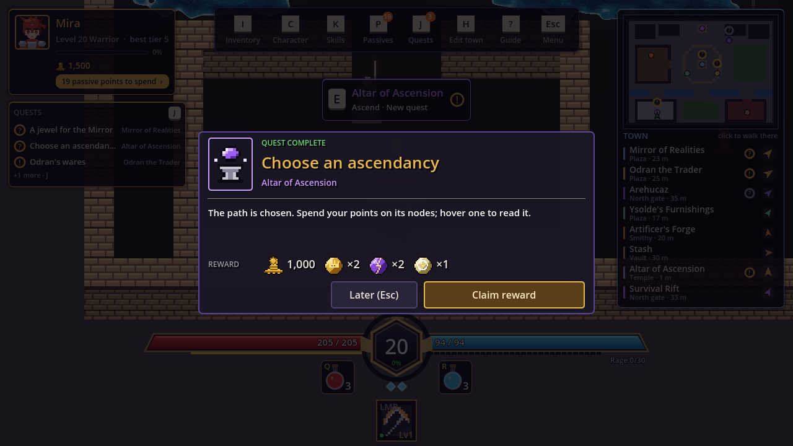
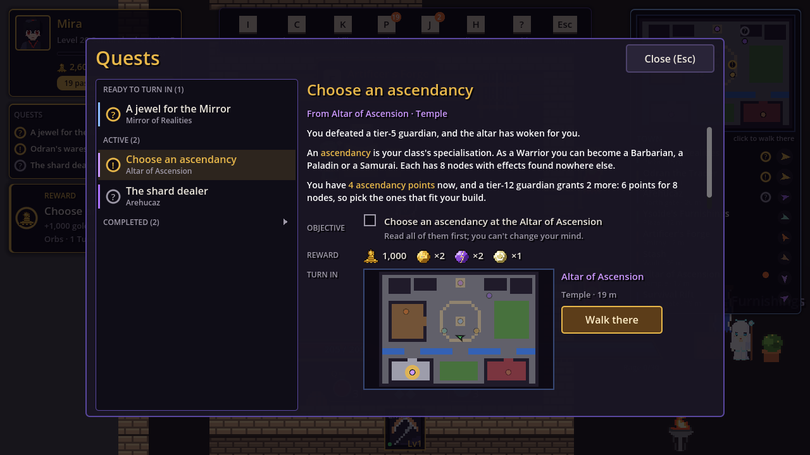

By now the town had Odran, the forge, Arehucaz, the Mirror's jewels and the
ascendancy altar, and nothing told a new player any of it existed. The UX review
produced a plan ([quests](https://github.com/AlvaroFalcon/arpg_game/blob/main/docs/design/quests.md)) and the next session built it.

## Six quests, one station each

Each teaches a station the moment it opens up: Odran's wares (after the
introduction), *Breaking it down* and *A modifier of your choosing* at the
forge, *The shard dealer* (a tier-2 clear, because Arehucaz only sells tiers
you've cleared above 1, so a tier-1 boss would unlock a quest the shop couldn't
serve), *A jewel for the Mirror* and *Choose an ascendancy* (the tier-5 boss, for
1,000 gold and some orbs).

How it reads in play: a quest unlocks by itself with a toast and a chime. Its
station gets a gold "!" in the world, on its directory row, on both maps and on
the E prompt; E at the station opens an **explanation first and the panel
second**, with a one-line strip under the panel's title. Doing the thing turns
the strip green; closing the panel opens the turn-in. J opens the log with the
objective as a drawn checkbox, rewards as icons and the town map with the
turn-in ringed.

## How it's built

`QuestBook` is plain C# over two progress maps (per character and per
account), so it is trivially testable. A `QuestService` feeds it events from
a static `GameEvents` bus (ten existing hook points, plus `boss_killed`,
`jewel_found`, `shard_found`, `hideout_entered`) and announces what changed.
Rewards pay through the player's wallet. Veterans get the quest skipped without
a reward, by decision of the owner. Saves are additive, so the version didn't
change, and the co-op join payload carries quests with the host capping them
(entry count, id length, status and count ranges), which the security suite
checks.

## Things that bit

- A class named `Quests` would have hidden the `ArpgGame.Quests` namespace, so
  the facade is `QuestService`.
- The first-visit guide opened a frame after the unlock toast and covered it for
  its whole six seconds. The arrival event now queues behind the guide.
- A "complete" card queued while another was showing outlived the panel it was
  about; stale cards are dropped.
- The big map's "New quest" suffix ran into the neighbouring badge and is now a
  second line.

Tests: 24 checks covering the rules, saves, the co-op caps, then the real
hideout, altar, forge, log, toast and a tier-5 boss kill.
