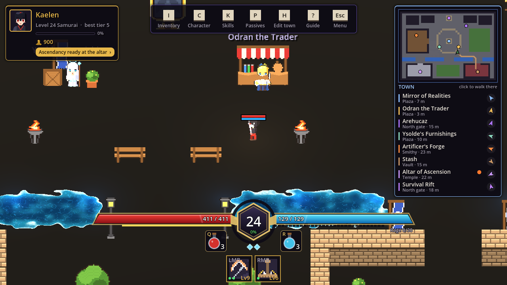
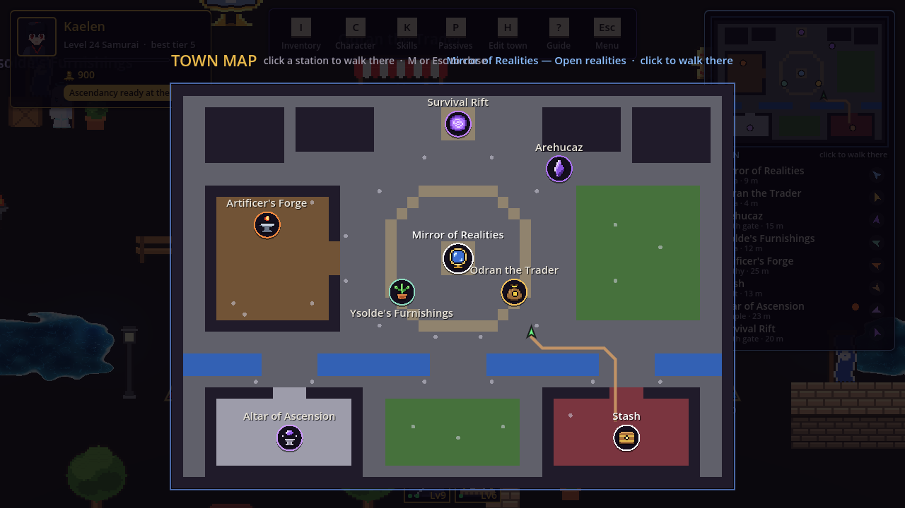
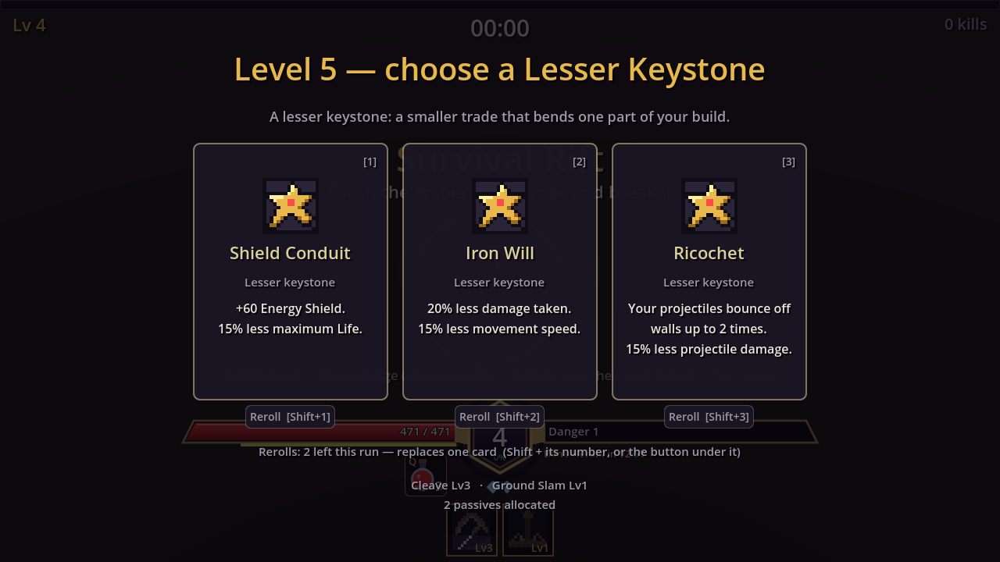
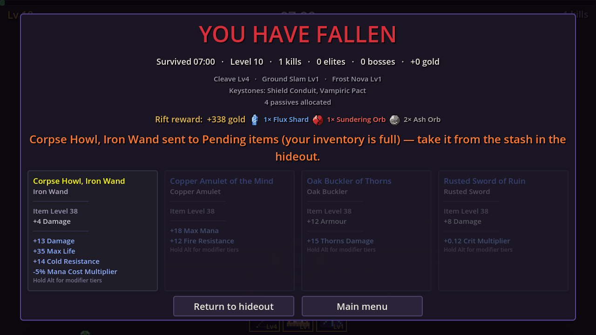
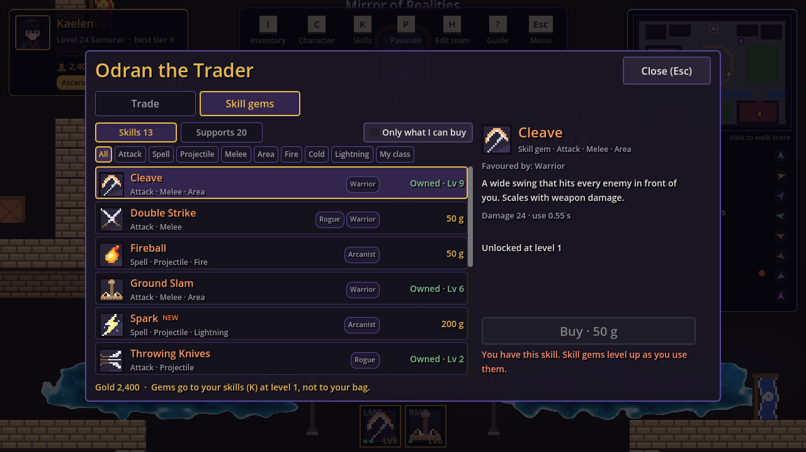
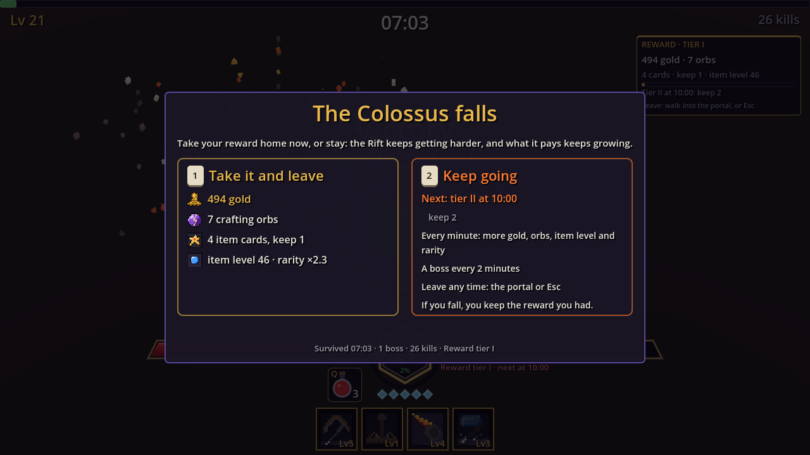
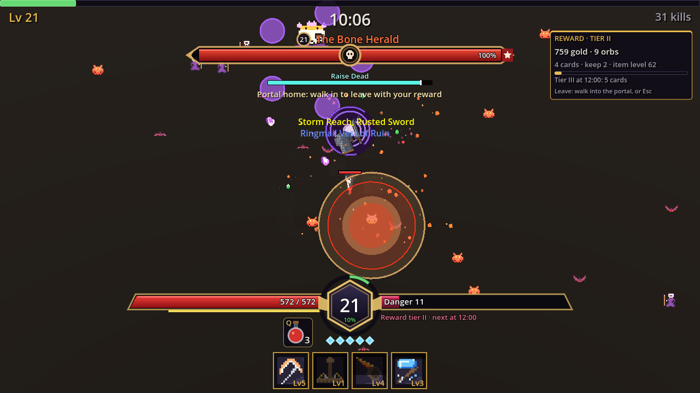

Between the big systems there are weeks of "this feels off" fixes. Here are the
ones that taught something, from 16 to 18 October.

## Small things that matter

- **Cursors.** Four pixel-art cursors (arrow with a garnet, a white-hot arrow over
  buttons, a sword over monsters, a gauntlet hand over loot) are hardware
  cursors scaled with the window, so they cost nothing and never lag. The
  character also faces the cursor while walking now, and **F** picks up the
  nearest item (hold it to empty a pile).
- **Level-up cards vanishing.** In the Rift, a stray Space (dodge) or Enter
  "clicked" the focused first card and the run continued with an upgrade you
  never chose. The level-up screen now owns the keyboard while open, swallows
  every key before the GUI sees it, acts only on 1 to 9 and R, and ignores input
  for 0.45 s after appearing. The first version of its test passed for nothing,
  because `Input.ParseInputEvent` delivers nothing headless; pushing events
  through the viewport does.
- **A settings panel that stayed the same size.** A tab container sizes itself to
  the open tab, so a long toggle on Display made the panel jump from 600 to 728
  px. Measuring hidden tabs fixed it at 720.
- **The launcher asks where to install**, shows free space, adopts an existing
  folder and catches unwritable folders before downloading.

## Town walks that don't get stuck

Clicking a station in the town directory walked you there, but often into
something. The navigation mesh was built from floor cells only, so stalls and
decorations didn't exist for it. The fix reuses the realities' monster
technique: a distance field per station on a 16 px grid whose blocked cells come
from physics queries with the player's own circle. The grid is offset half a
cell so one-tile doors have a free cell down their middle; without that, every
door in town is closed. A minimap and a full-screen town map (M) came along,
each station with its own icon, and clicking one starts the walk.

## A Rift with a shape

The owner's requests for the Rift, built together ([run](https://github.com/AlvaroFalcon/arpg_game/blob/main/docs/design/run.md)):

- A character with skills enters at level 1 with no supports and picks a start
  card; a skill-less character is offered three skills of its class. A bug on
  the way: a character level-up mid-Rift rebuilt the loadout and wiped the
  run's skills.
- **Keystone cadence:** lesser keystones at 5, 15, 25..., great ones at 10, 20,
  30..., nothing in between.
- **Offer composition** in one table: skill, power-up and support categories per
  card, with at least one skill card guaranteed. Measured: 57 % skills, 32 %
  power-ups, 11 % supports. New power-ups include an energy shield stat that
  takes hits before life.
- **Per-card rerolls** (a button under each card, or Shift+1/2/3), two per run.
- **Pending items:** a reward that finds the bag full goes to an account-wide
  overflow that shows as a stash tab and a hideout banner.

The bot showed the ascendancy clearly (damage taken down about 5x) and that a
level-20 character wins every time, which means the Rift does not scale with
character level, an open question left for the owner. Then the owner asked for a
denser Rift: spawn rate and alive cap gained a quadratic term, swarms come every
60 s shrinking to 30 s, and from 4:00 a second ring of another kind joins.

## A UX review, then three builds

On 18 October a planning session turned four owner requests into plans from
fresh captures. Then they were built.

**Instant tooltips.** Orb buttons used Godot's built-in tooltip, which waits
half a second and restarts when the mouse moves, while our item tooltips show on
the first hover frame. A themed tooltip now shows on the very frame the mouse
enters, used across orbs, seal, dust, HUD and more; disabled buttons keep their
mouse filter, so an orb you have none of explains where to get it. A headless
window has no pointer, so the proof is a capture.

**Odran's Skill gems.** A second tab sells all skills and supports by character
level, with locked rows greyed, filter chips and "Only what I can buy". Three
new skills fill gaps: Frost Shards, Storm Strike and Glacial Hammer. The review
also found that the ascendancy altar's "Become a..." is permanent and took one
click, so it now asks twice.

**The Rift's cash-out.** The Colossus kill now holds the director for 1.2 s and
asks: take the reward now, or keep going into the endless phase. The portal and
Esc open the same panel later. A HUD panel shows the reward tier and the way to
the next, with V and up adding guaranteed Rare cards and then Ascendant Orbs. In
co-op it is a 15 s party round, silence counts as leave. The bot takes the
reward at the kill, so balance numbers stay comparable. One test lesson: a scene
added under a test node that never pauses never pauses either, so Rift checks
use a pausable holder.

