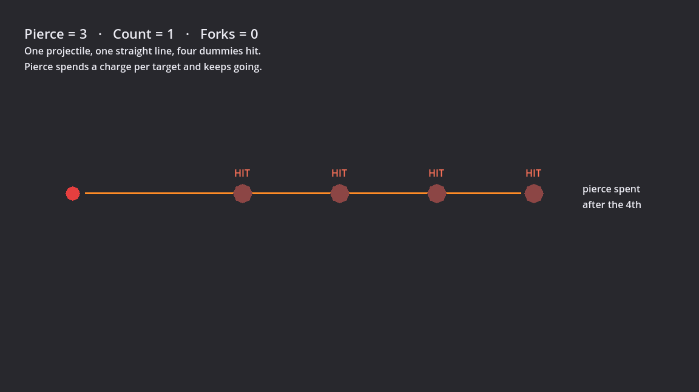
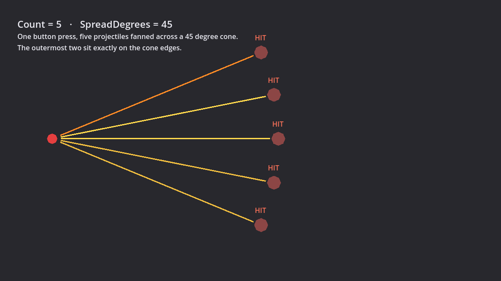
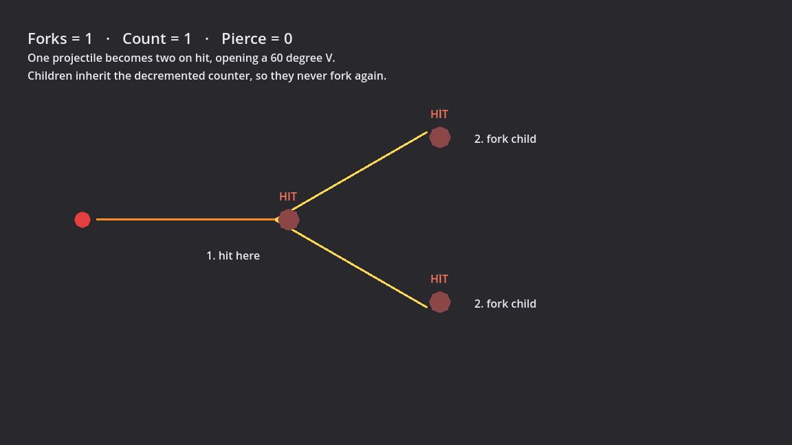

The [last post](../movement/) left off with a shape that could walk
around a grey rectangle. This one is the direct sequel: that shape can now
cast a projectile skill, the projectile can hit things, the things can die,
and the skill itself has enough hidden capability that two new behaviours
went in without touching its parameter list. Still no enemies, no AI, no art,
no UI beyond debug text — everything below was tuned against a stationary
target dummy, and every number in it is a placeholder. What's actually new is
the architecture underneath, and specifically the three times it got
rewritten before any of it shipped.

## Three passes, and what got reversed each time

`docs/design/skills.md` went through three design passes before a line of
`scripts/Skills` existed. The interesting part isn't the final shape — it's
what each pass undid from the one before, because the reversals are where the
actual reasoning lives.

**Attack speed and cast speed went back to being derived from tags.** Pass
two gave `SkillDefinition` an explicit `SpeedStat` field: author which stat
scales the skill's use time, done. Pass three reversed it, back to deriving
the answer from the skill's own tags — `Attack` skills scale off
`AttackSpeed`, `Spell` skills off `CastSpeed`, anything tagged neither doesn't
scale at all. The reversal wasn't a style preference. **The tag is the
contract the player reads.** Every tooltip, every filtering modifier, every
piece of UI that will ever exist reads the tag. If a skill is tagged `Spell`
and a field on the definition secretly says it scales with attack speed
instead, that's a lie the player has no way to detect — two independent
notions of "is this a spell" that can silently disagree, with no UI ever able
to surface the disagreement. Deriving both from the same tag makes the lie
impossible to author. The cost, named honestly in the design doc: `Attack`
and `Spell` are now **structural** tags — re-tagging a skill changes what it
does, not just what it's worth, which is a real exception to "tags are cheap
to edit" and worth remembering later.

**Cooldowns moved into the first slice instead of staying deferred.** Pass
two treated cooldown as a nice-to-have; pass three promoted it, because it
turns out to be the *only* rate governor for anything tagged neither `Attack`
nor `Spell` — a dash, a warcry, a toggle. Without it, those skills have no
mechanism limiting how often you press them. Cooldown recovery is a **rate
divisor**, not a subtraction: `effectiveCooldown = Cooldown / CooldownRecovery`,
where `CooldownRecovery` starts at 1.0 and modifiers push it up. The
alternative, "-X% cooldown," is the one PoE itself moved away from, because
it hits 100% and the skill's cooldown vanishes — a divisor is asymptotic and
can't reach zero no matter how much gets stacked on it. Cooldown also starts
counting on cast *start*, not cast end, so a build that stacks cast speed
doesn't quietly get free cooldown reduction as a side effect nobody asked for.

**Tracing one example split the modifier system in two.** The design doc
walks through the owner's own first instinct for an upgrade — "projectiles
split in two on hit" — end to end, and that trace is what found the gap.
It's tempting to write that as a `StatModifier`: some `Flat`/`Increased`/`More`
number on a stat called "split count." But there's no actor stat called
"split," the F/I/M formula is meaningless for it ("+50% increased splitting"
isn't a sentence), and critically: **writing the number does nothing on its
own.** A `StatModifier` never needs the thing that reads it to know it
exists; a behaviour transform always does — something has to check for it and
act. That produced a second modifier kind, `CastModifier`: instead of
targeting an actor's stat, it targets the per-cast parameter block directly,
via an `Apply(CastContext)` method rather than a number, and because
`+1 projectile` then `double projectiles` gives a different answer than the
reverse, it carries an explicit `Priority` and applies in a stable sort
rather than whatever order it happened to get inserted in. The design
argument underneath the split is worth stating on its own: **players
remember behaviour transforms and forget numeric ones.** Nobody's build
identity is "+12% damage" — it's "my projectiles fork," or "my fireball
ignites." Every build identity in this genre, from PoE's supports to Hades'
boons, is a behaviour transform. Pass two's seams were only built for the
forgettable kind.

## Archetype decides what a skill does, tags decide what can grab it

One more distinction runs through all of this, worth stating briefly because
the rest of the post leans on it. A skill has exactly one **archetype**
(`Projectile`, eventually `MeleeStrike`, `AreaBlast`) — a closed set, and it's
what the skill user dispatches on to decide which executor runs. A skill also
carries **many tags** (`Fire`, `Spell`, `Projectile`, `Area`...) — an open,
data-driven set that conditional modifiers and future UI filter on. The rule
that keeps them from collapsing into each other: *executors* must not branch
on tags, but *scaling and modifier selection* must. Confusingly, the word
`Projectile` legitimately appears in both columns and means two different
things there — as an archetype it says "the projectile code executes this,"
as a tag it says "modifiers that care about projectiles apply here." A melee
skill that throws a shockwave could have archetype `MeleeStrike` and still
carry the `Projectile` tag; its executor is melee, but a "+1 pierce to
projectiles" modifier still finds it. Fireball itself is archetype
`Projectile`, tags `Fire, Projectile, Spell`.

## The payoff: two capabilities, one method changed

All three reversals above fed into one concrete rule for how executors get
written: **as a parameterised capability set with everything off by default,
not as a minimal implementation of the one skill that exists today.** The
projectile executor was authored in the first milestone with its full
eventual parameter list — count, spread, pierce, forks, chains, bounces,
homing, size, on-hit-explode — sitting on `ProjectileParams`, and only
`Count = 1, Pierce = 0` actually did anything.

This session wired up two of those dormant parameters, and it's the first
real test of whether that up-front structure was worth it. Pierce was
already load-bearing from the M1 slice — a piercing bolt just keeps going,
spending one pierce charge per target hit, until it runs out or reaches its
range:

`Count` and `SpreadDegrees` — fanning multiple projectiles from a single
cast — turned out to be a change to exactly one method,
`GenerateProjectileSpawnRequests`, because its caller already consumed a
`List<ProjectileSpawnRequest>` rather than spawning a single projectile
directly. Spread has two regimes: under 360 degrees it's a cone divided by
`Count - 1`, so the outermost two projectiles sit exactly on the cone's
edges; at 360 or above it switches to a full nova divided by `Count`, so the
first and last don't land on top of each other. Worth calling out: `Count > 1`
with `Spread = 0` deliberately stacks every projectile into a single "slug"
rather than getting auto-corrected into a fan the author didn't ask for —
Hell Clock's Blunderbuss relic is exactly that effect, and silently
overriding an odd-looking configuration is worse than leaving it odd.

## Where the design doc turned out to be wrong

The doc claims, in the section proposing the fork/chain mechanism, that chain
and fork are "both Redirect with a decremented counter" — the same on-hit
outcome, just reused. Implementing fork is what found the claim false. Chain
is one projectile continuing toward one new direction, which `Redirect`
expresses fine. Fork is one projectile becoming *two*, and there's no single
new direction to hand back. `OnHitOutcomeKind` needed a fourth member,
`Fork`, under which the parent despawns and the executor spawns two children
opening a 60-degree V around the parent's heading:

It's worth being fair to the doc here rather than just marking it wrong. The
seam it built — on-hit resolution as an explicit, inspectable value instead
of an inline decision buried in the hit handler — is exactly what made adding
a fourth outcome kind a small, contained change. Only the prose describing
what fork *was* turned out to be inaccurate; the structure it sat inside was
right. Fork children also inherit the parent's already-travelled distance
(one shared range budget between parent and children, so forking trades reach
for coverage rather than being strictly better than not forking) and the
parent's already-hit set — the same tracking structure that was justified
back in M1 purely for pierce, now doing a second job: stopping a fork child
from instantly re-hitting the target its parent just split off of.

## The test that couldn't have failed

This is the best material from the session, and it's a direct callback to a
trap from the movement post. The first version of the "fork must not
cascade" test — Forks = 1 should never produce a third generation, since
children inherit the decremented counter — worked by casting one bolt into
empty space and counting how many projectiles existed a while later. It
**passed with the bug deliberately reintroduced**, where children kept an
*undecremented* fork counter. The reason is almost embarrassing in
hindsight: fork children fly apart at ±30 degrees from the hit point and
there was nothing else in the scene for either of them to hit, so neither
child could ever reach a second hit regardless of what its counter said. The
test wasn't weak — it was structurally incapable of failing, because the
value it asserted on wasn't something the bug could influence either way.

The fix was to give a child something to hit: a second dummy placed on one
child's flight path. Correct behaviour leaves one live projectile (the
untouched sibling); the reintroduced bug leaves three (the sibling, plus the
child that hit the second dummy forking again into two more). Re-breaking the
counter now genuinely flips the test to `FAIL`.

This is the same shape of mistake as `MovementSmokeTest` driving
`Input.ActionPress()` on an action with zero keys bound to it, from the
movement post — a test asserting on something the bug is free to leave
untouched. Different subsystem, same failure mode, and apparently a pattern
worth actively watching for rather than a one-off. `SkillsSmokeTest` sits at
7/7 and the new `ProjectileCapabilitiesTest` at 5/5, both re-verified against
the deliberately-reintroduced bug rather than just a clean pass.

## Two capture bugs, both quietly plausible

Generating the screenshots above needed a small tool
(`scripts/tools/SkillCapture.cs`) that scripts through pierce/fork/spread in
sequence and draws every projectile's full flight path as a `Line2D`, marking
which dummies got hit. It hit two bugs, and both are worth a sentence each
because they produced *wrong but entirely believable* images rather than
obvious garbage.

The pierce capture was screenshotted at a fixed frame that turned out to be
short of how long the projectile actually needed to travel to the fourth
dummy at the reduced capture speed — so the image showed three hits and a
trail stopping short, which looks exactly like an off-by-one in the pierce
counter. It wasn't; it was pure screenshot timing, fixed by giving each
capture phase enough duration to outlast the real flight time. Separately,
recolouring a hit dummy through its polygon's `Color` property silently did
nothing, because `TargetDummy` runs its own short white hit-flash that
restores the base colour a few frames later — overwriting the capture tool's
change without either side knowing about the other. Switching to `Modulate`,
a property the dummy never touches, fixed it.

## What's next

Per the design doc's own priority order, next up is a dash and a second,
non-projectile skill — deliberately chosen because a dash forces the
cooldown lever to actually matter (no attack/cast speed tag applies to it)
and a second archetype is the first real test of whether the archetype/tag
split holds up outside `Projectile`. After that: one hostile enemy that can
actually be hit back by, followed by an enemy casting the player's own
`Fireball.tres` — the concrete test of whether "one skill definition serves
both sides" is true or just a nice sentence in a design doc.

Explicitly not next, on purpose: the passive tree, the artifact/socket
system, and more skills for their own sake. The design doc's own reasoning
for holding off is worth repeating rather than paraphrasing badly — the
passive tree is simultaneously the most enjoyable thing in the whole project
to *design* and the most expensive thing to *author*, and every node in it is
a guess until modifiers, tags, and conditions have actually been played
with. Building it now would mean authoring hundreds of numbers that all get
rebalanced from scratch later, while feeling like enormous progress the
entire time — which is exactly what makes it a dangerous thing to reach for
early.
