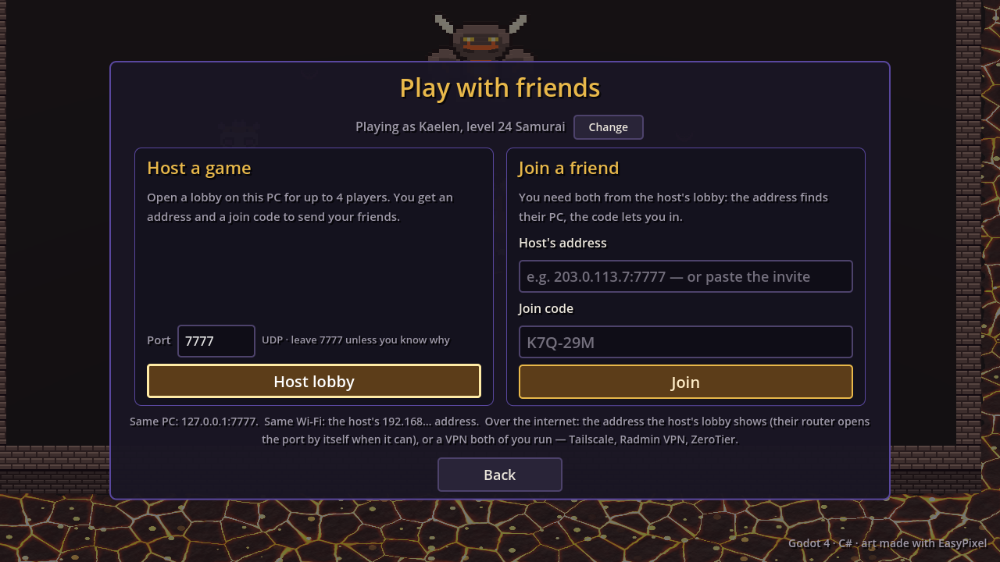
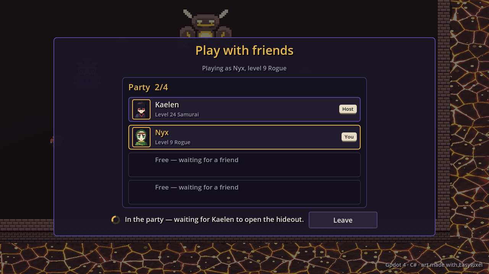

Phase one of co-op ([the previous post](../co-op-survival-rift/)) was "one
run". The owner wanted it to feel like a *party*: play with friends from Play,
meet in the host's hideout, anyone proposes a rift and everyone gets a popup,
invite from the pause menu, and only edit the host's town with permission.
Phase A did this for the Survival Rift; phase B, a day later, brought Altered
Realities. Design in [multiplayer](https://github.com/AlvaroFalcon/arpg_game/blob/main/docs/design/multiplayer.md).

## Phase A: the party

- **Session plumbing.** The session has a phase (lobby, hideout, run, returning)
  and each member a place. Results returns to the hideout and keeps the party;
  leaving a run leaves the rift, not the party; the router port stays open
  between rifts; joining is open whenever there is room.
- **A shared hideout.** Each machine runs its own hideout with its own panels
  and wallet; the host's town layout and everyone's presence are shared. The
  scary bug class here was a guest saving the host's town over their own, so the
  hideout keeps the town on screen and the account's own town apart, and the test
  uses guest saves that really write.
- **Proposals.** A pure rule on the host: if the host declines or doesn't answer
  it's cancelled (owner rule); otherwise it starts with whoever said yes, and a
  "yes" re-sends the character so the host builds what you bought in the hideout.
- **Invite friends** hosts in place from the hideout's pause menu; Stop hosting
  leaves the host alone in the same town.
- **Edit permission** per friend, one editor at a time, and the guest's whole
  layout is checked on the host (stations kept, nothing on walls, every
  decoration and tile conserved).
- Play now splits into **Solo** and **With friends**, and new characters that
  haven't done the introduction are asked first.

Two things that bit:

- **ENet's packet throttle** dropped 30 to 70 % of guests' *unreliable* presence
  on loopback while ENet's own loss counter said 0: the throttle drops unreliable
  packets whenever round trips vary, and a game servicing the socket once per
  frame varies a lot. Presence is a few bytes at 10 Hz, so it is reliable now.
- **Idle C# compiler servers** (about 1 GB each) starved the multi-process tests
  until guests ran at 1 fps. The test runner shuts the build server down after
  building.

## Phase B: Altered Realities with friends

A party can now open a reality of any tier together. Whoever proposes it from
the Mirror pays the shard, only when it starts; the host always goes; whoever
says no waits in the hideout.

**First a pure move.** The Rift's host and client classes were 2,500 lines typed
to the Rift. The shared part (snapshots, events, capture and replay, prediction
and reconciliation, instanced drops, boss tracking, the load handshake) moved
into abstract base classes over a small world interface, and the Rift's
subclasses keep only their own numbers, rounds and revives. The snapshot bytes
are identical: the existing co-op test passed untouched.

Then the reality itself:

- The **same cavern on every machine** from the host's seed; only the host
  simulates. The replication node enters the tree before the packs spawn, because
  capture is driven by node-added events; a bug the test caught was the boss
  record going out before anyone was ready.
- **Realities cast on press.** The Rift auto-casts, so its input never carried
  buttons. A reality client now sends the six skill buttons it holds, and the
  host casts at the client's cursor. In bound-cast mode a remote copy on the host
  would have read the *host's* keyboard and mouse; it now reads only its command.
- **The save-safety fix.** In solo, pickups write shards, jewels and gems straight
  into the active profile. In co-op that would have put every friend's drops in
  the host's account. Remote pickups now tell the owner's machine, which applies
  them through the same path as solo.
- **Party rules:** monster life x1.5/2/2.5, boss x1.7/2.4/3.1, packs x1.2/1.4/1.6
  by party size (two, three, four players, in that order); +15 % quantity and +10 % rarity per extra player;
  a shared portal pool; the boss arena pulls everyone in; every participant gets
  the kill's experience and a full loot table of their own. Monsters chase the
  nearest player through one multi-source flow field.

Measured (four players, tier 10): 16 KB/s per client exploring, 8 KB/s in the
boss fight, replication under 0.5 ms. The open question about ENet's throttle
got an answer: snapshots arrive 98 to 100 % on loopback, inputs lose 3 to 10 %,
which is harmless since inputs carry full state.

## Still unproven

Everything here is tested on one machine. What needs real friends: the popup and
puppets at 100 to 200 ms ping, UPnP when hosting from the hideout, a guest
editing the host's town over the internet, a reality boss fight with latency
(casts show after the round trip; there is no cast prediction), and frame time
on four real PCs.
