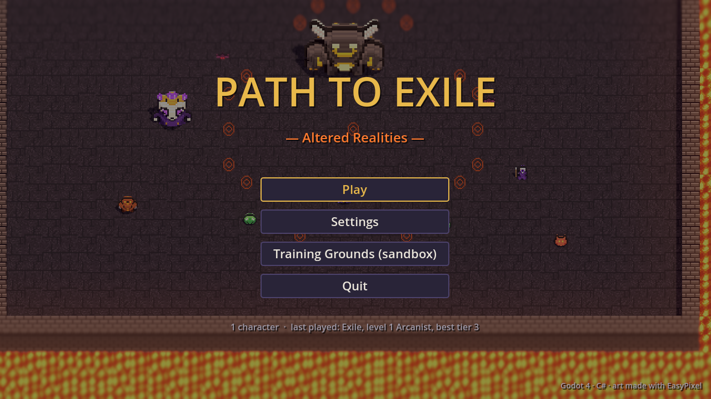
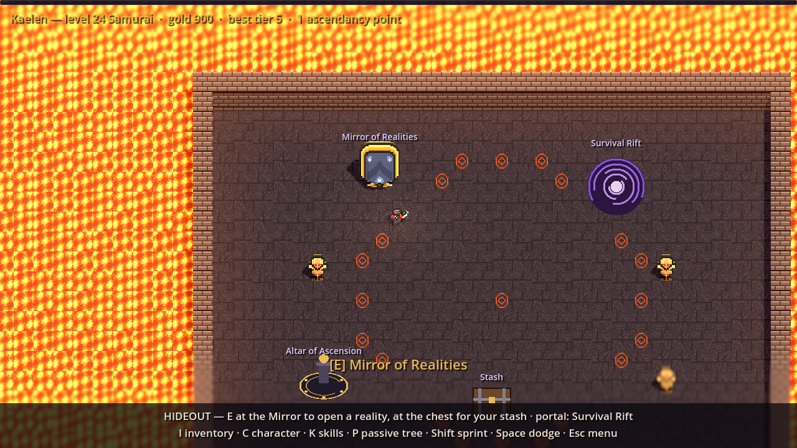
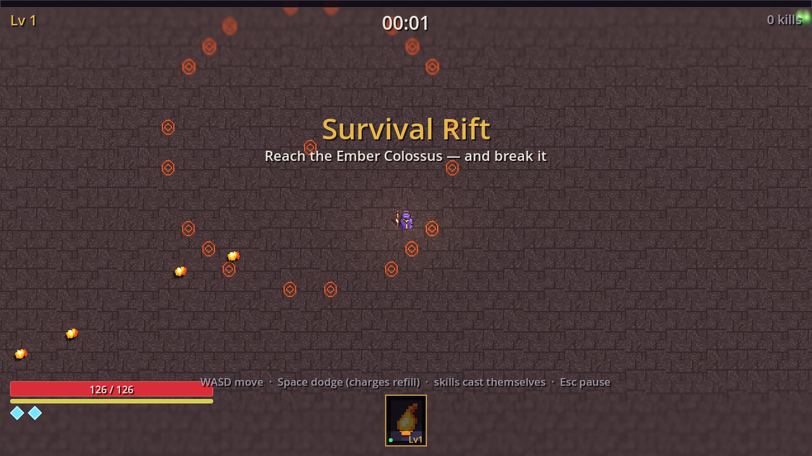
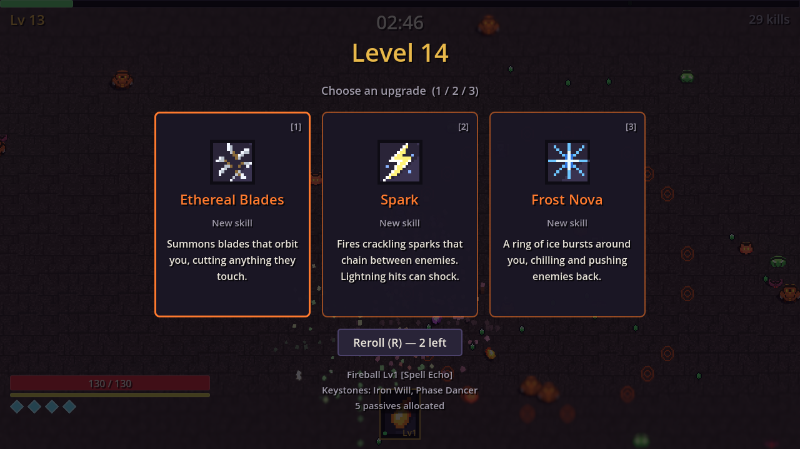
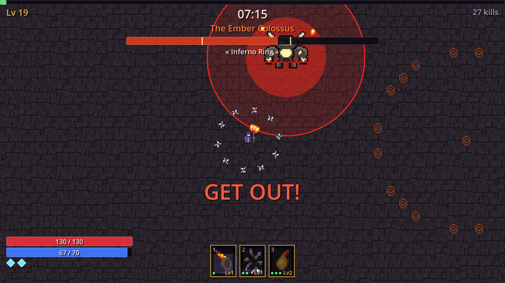
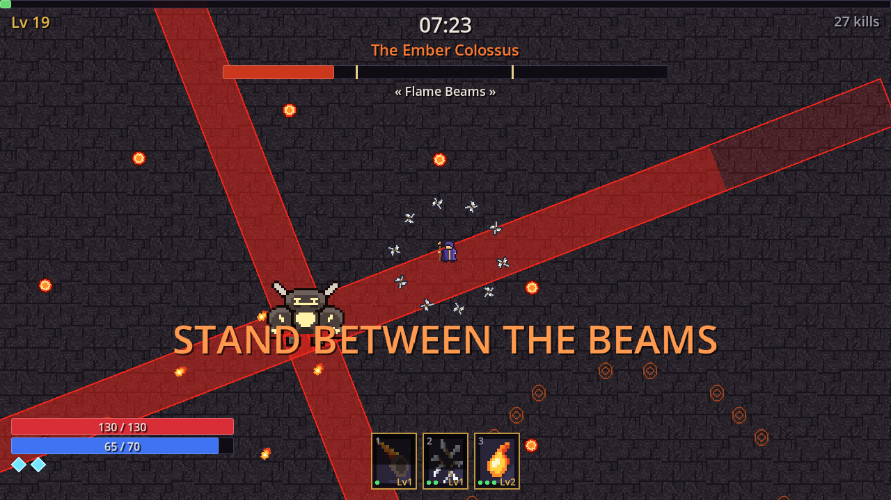
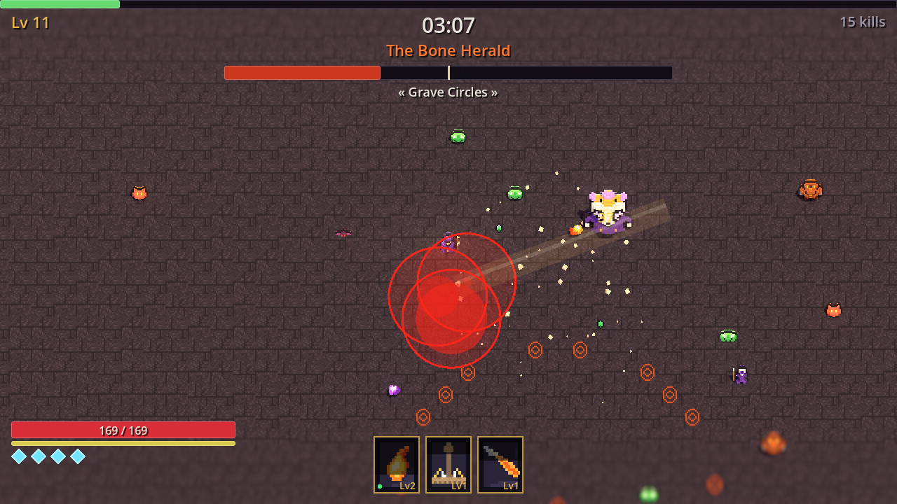
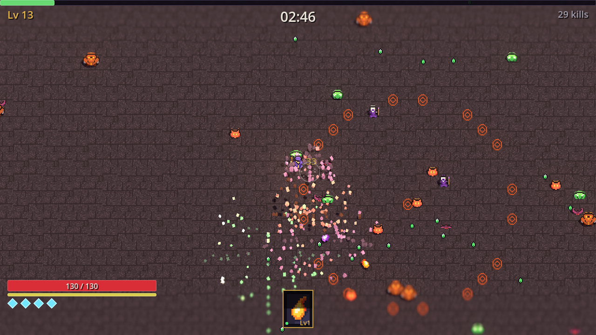
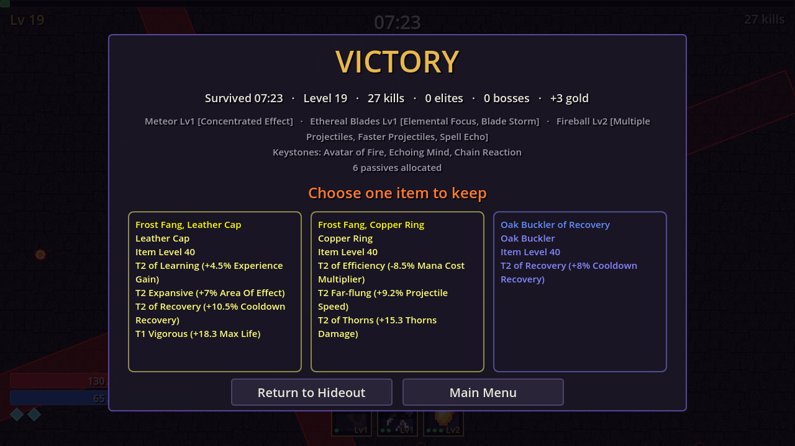

Until last night, ARPG Game was a very well-tested sandbox: a mage, some
training dummies, a fireball with forks, an affix system, a grid inventory.
Every system was there; nothing to *do* with them. This post is about the night
it turned into a game — a Vampire Survivors-style run with a Path of Exile-style
character — and about the parts that were easy because of decisions made weeks
ago, and the parts that weren't.



## The shape: survive in the run, keep the gear

The design fits in one sentence: *a survivor-style power curve inside a run,
an ARPG character across runs.*

You start in a small **hideout** with your gear, an inventory and some training
dummies. Walk into the portal and you're in the **Ashen Arena** with one skill of
your choice. Seven and a half minutes later — if you're still alive — you're
fighting the **Ember Colossus**. Win or lose, the results screen offers three
items and you keep one. The level-up build is thrown away; the gear isn't.





## Build depth was already paid for

Weeks ago the skills design added a sixth "seam" called `CastModifier`: a
behaviour transform applied to a per-cast copy of a skill's parameters. "+1
projectile", "projectiles fork on hit", "add the Fire tag". Zero subclasses
existed. The pipeline stage ran over an empty list every single cast, on
purpose, so that the first real upgrade wouldn't need a rewrite of the cast path.

Last night the first real upgrades arrived, and the cast path didn't change. A
**support gem** is just a named `CastModifier` living on the skill instance:

```csharp
new SupportDefinition
{
    Id = "multiple_projectiles", Name = "Multiple Projectiles",
    Description = "+2 projectiles, fanned out.\n20% less damage.",
    RequiresAny = SkillTags.Projectile, Priority = 10,
    Apply = c =>
    {
        c.Projectile.Count += 2;
        SkillUser.EnsureSpreadForCount(c.Projectile);
        c.DamageMultiplier *= 0.8f;
    },
},
```

Seventeen of those, twenty-nine stat passives that roll a rarity, and seven
keystones. The combinations come for free from decisions that were already
made: damage type is derived from tags, and damage modifiers are filtered by
tags. So *Cold Conversion* on Fireball doesn't need to know anything about
Fireball — it rewrites the cast's tags, the hit becomes Cold, Cold always chills,
and every "increased Cold Damage" passive you own starts applying to it. *Avatar
of Fire* is the same trick applied to every skill at once. *Blood Magic* rewrites
the per-cast cost list from Mana to Life, which is exactly the case the "costs are
a mutable list, never a scalar" rule was written for back in the first combat pass.



The Bone Caster enemy, meanwhile, shoots a `ProjectileSkillDefinition` through its
own `SkillUser`. "One skill definition serves both sides" has been a hard rule
since the first skill; it's nice to finally see it on screen.

## Telegraphs: one visual language

The brief for the boss was *complicated mechanics, but clearly marked*. The way to
get "clearly marked" without trusting every boss script to remember is to make it
impossible to hit the player any other way. Bosses don't deal damage directly:
they spawn an `AreaBurst` (circle or donut) or a `LineStrike` (lane). Both draw a
faint red zone for the full area and a brighter fill that grows until it lands —
exactly when the fill completes. Hostile ones are always red, whatever the
element. Player Frost Nova and Meteor use the same runtime, in their own colours.

On top of that, every attack is named under the boss bar, and the attacks you
must react to right now get shouted.





The Colossus has three phases: a slam followed by an aftershock ring (so leaving
the slam *just barely* isn't enough), molten rain that lands slightly ahead of
where you're running, a charge along a drawn lane, fans of slow orbs; then the
in/out **Inferno Ring** and summons; then an enrage with rotating flame beams. The
mid-run Bone Herald exists to teach that vocabulary three minutes earlier, with
smaller numbers.



## A dodge you have to budget

Space dashes with 0.3 s of invulnerability — but you hold two charges, and each
refills on its own 2.4 s timer. You can chain two dodges through a combo; you
can't dodge everything. Both numbers are stats, so a notable passive adds a
charge and the *Phase Dancer* keystone builds an entire character around rolling
(every dodge releases a frost nova, at the price of taking more damage).

## Balancing with a robot

Nobody has played this yet, so the balance pass was done by a bot. It runs a full
game headless at about three times real speed, flees nearby enemies, steps out of
anything red, dodges hits about to land, collects gems, and picks level-up cards
at random — a deliberately average player.

The single most useful thing it did was log **damage by source** when it died:

```
[BOT] damage by source: Bone Caster (attack) 409, Elite Bone Caster (attack) 70
```

Thirty casters alive at once is artillery, not enemies, so ranged enemies are now
capped. Next it was brute charges and bat swarms — so the bot learned to read
brute lanes and dodge *out* of a crowd, the way a person would. Then the Herald sat
at 100 % for ninety seconds while the bot's auto-aim shot the adds in front of it;
auto-aim now prefers a boss in range. Last batch: two wins out of six, the other
four dying between 3:30 and 5:00. That's the target — usually reaches the Herald,
sometimes beats the Colossus — for a player who picks cards at random.



## Art from text

Everything visible was drawn with EasyPixel. Not through its window: a cloud
session can't drive the Electron app, but EasyPixel's core package has no DOM, so
the same `draw_grid` format its MCP server takes — one string per row, one
character per pixel — runs from a Node script and goes out through EasyPixel's own
Godot exporter. Every sprite's `.epx.json` is saved alongside, so any of them can
be opened in the app and repainted by hand.

```ts
const slimeA = sym([
  '....kkk',
  '..kkGGG',
  '.kGGwGg',
  ...
]);
```

## What's not done

No human has played it. Every number comes from a bot with perfect 0.22-second
reactions and no taste in builds. Gold has no sink, there's one arena, the audio is
synthesised placeholder, and clicking an out-of-reach item inside a run doesn't
walk you to it. Next up is the obvious one: play it.


