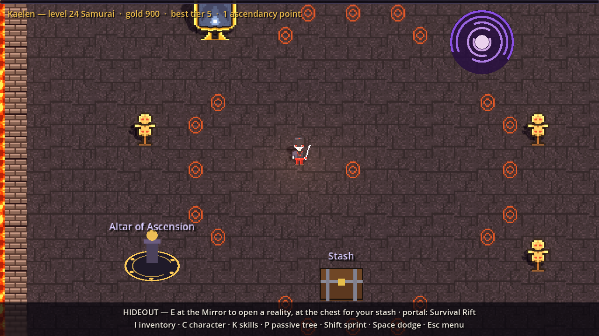
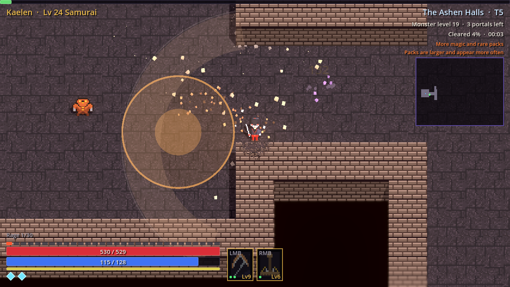
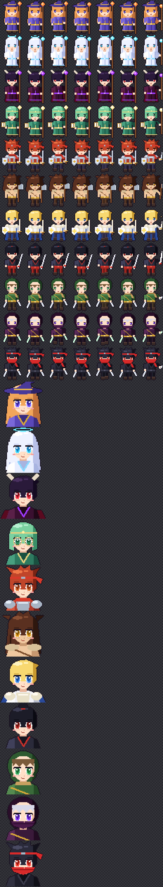
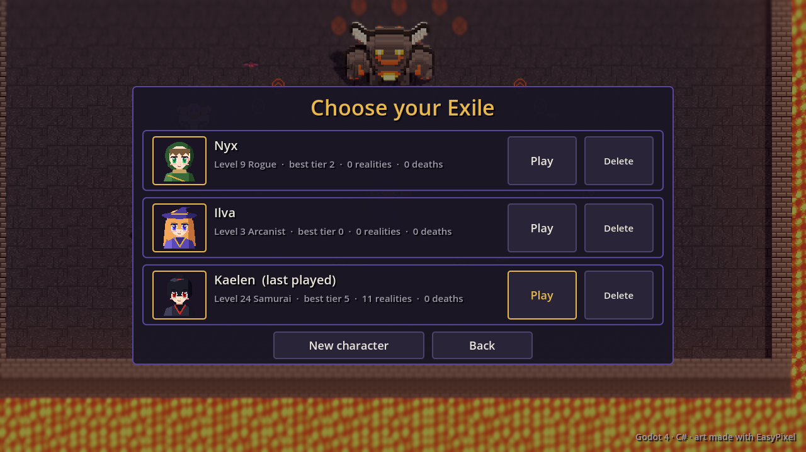
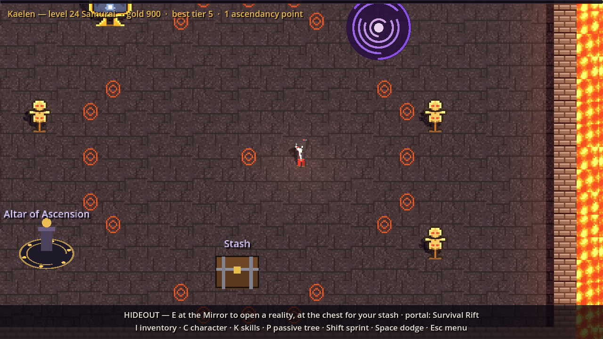
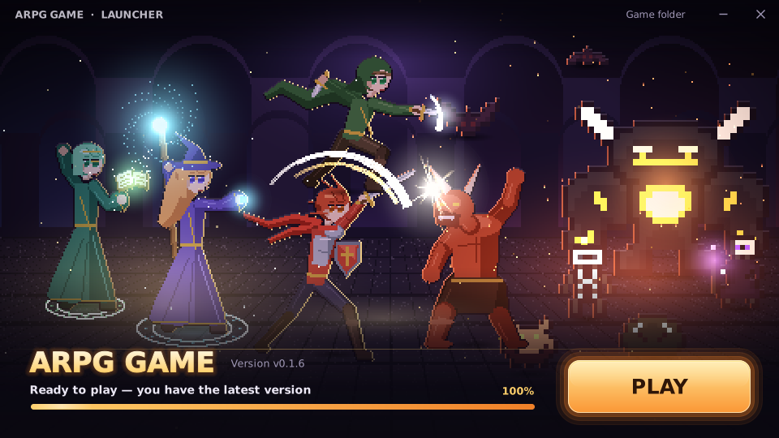
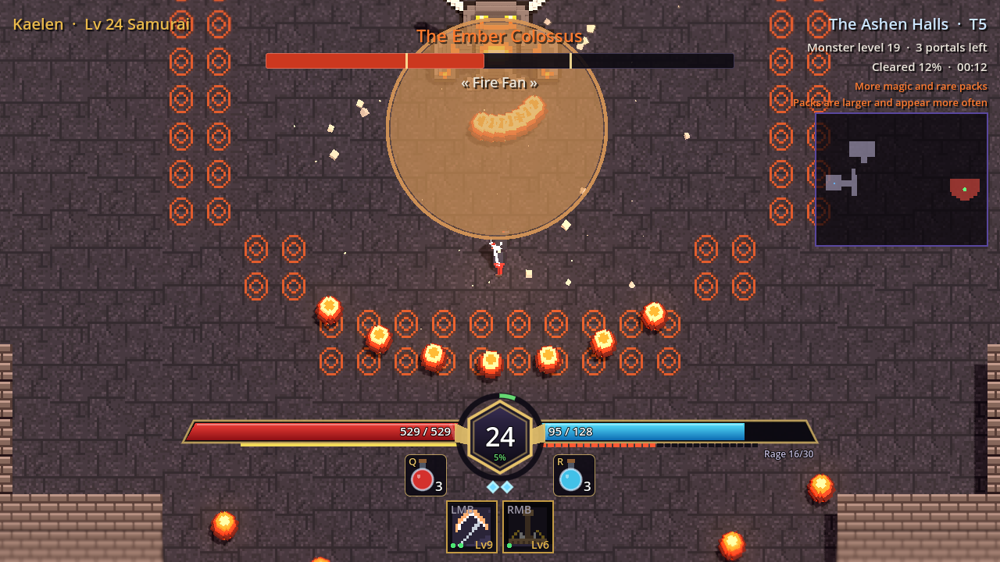
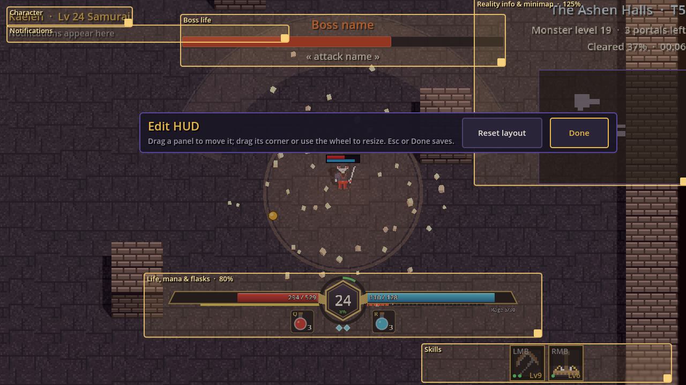
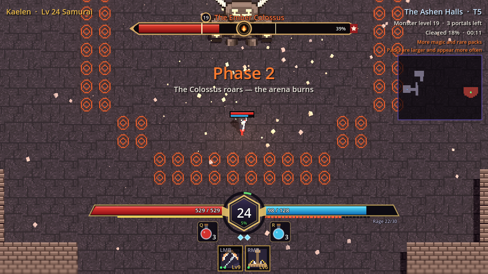

After the endgame pivot the owner's feedback was mostly about *how it looks and
feels*. Twelve hours produced a different-looking game. This is the tour, with
the trade-offs.

## Voxels without porting the game to 3D

EasyPixel 0.2 exports voxels, and the owner wanted them as the main graphics
with an HD-2D look. Porting gameplay to 3D would have been weeks. Instead the
**2D simulation stays and a voxel world renders under the canvas**. The trick is
the camera: orthographic, pitched 40 degrees, with the whole 3D world stretched
in depth by 1/sin(pitch), so the ground plane lands exactly where the 2D world
was drawn. Every telegraph, label and damage number keeps lining up without
touching gameplay code.

A script turns each sprite frame into an inflated voxel figure and each tileset
into slabs and brick walls. Monsters burst into cubes of their own colours,
heavy hits kick up floor and chip walls, walls dither away in front of the
player, and the Forward+ renderer adds shadows, lava lights, glow and tilt-shift
blur.

**Seeing it in the cloud.** Our usual virtual-display captures use the
Compatibility renderer, which in Godot 4.1 has no shadows, glow or depth of
field, so the first voxel screenshots looked flat for that reason alone.
Installing Mesa's software Vulkan driver and rendering with it shows the real
thing, slowly.

Honest limits: pickups, telegraphs and UI stay flat 2D on top, walls only shed
chips, and the camera is orthographic rather than a true perspective.

## Anime characters at double resolution

The owner found the sprites too small and wanted a Japanese anime look plus
portraits. Characters went from 16x24 to 32x48 at half the scale, so nothing in
gameplay moved. Drawing at that size row by row would be miserable, so a tiny
painter paints shapes and an outline pass, and one parametric chibi produces all
eleven classes and ascendancies from a "look" (hair, armour, weapon, palette).
The same look paints a 64x64 bust for character select. The first portraits
hid the eyes under the bangs; the fix was to draw the face *after* the hair.
Upright voxel figures also cancel the stage's depth stretch and lean back 30
degrees, so the camera stops seeing mostly the tops of heads.

Later, for the launcher art, a joint-based rig paints figures from joints
(tapered limbs, flowing hair, capes), and characters now have front, back and
profile sheets and face where they move or aim.

## A name, a launcher, and what broke

The repo went public, so the game dropped its provisional title everywhere for
the placeholder "ARPG Game", and a small migration copies old saves. Builds are
published by a GitHub Actions workflow, and a tiny .NET Framework launcher
installs and updates the game from the latest release (the rejected options for
distribution are in [distribution](https://github.com/AlvaroFalcon/arpg_game/blob/main/docs/design/distribution.md)).

The first real launcher run hit a 404: a PR merge had just published a release
whose files were still uploading, and the "latest" link pointed at it during
that window. The launcher now asks the releases API for the newest release that
already has its zip. The launcher 2.0 became a borderless, custom-drawn window
over key art generated from the game's sprites; a first draft with a literal
"VS" over a rift of light was too on the nose, so it became a fight instead.

## Flasks and a HUD from a reference

Flasks arrived as planned in the items design: Q drinks the life flask, R the
mana flask, three charges each, and red orbs now refill charges instead of
healing directly. The owner sent a screenshot of another game's HUD as a
reference, so vitals became one bottom-centre cluster: life and mana meeting at
a hexagonal level badge with an XP ring, flasks as bottles, dodge diamonds and
the skill row. The first draft spammed "triangulation failed", because the
bottle's liquid polygon had repeated points; a proper circular segment fixed it.

Then the HUD became the player's: Esc, Edit HUD frames every movable panel and
lets you drag it, resize it from 50 to 200 % with a corner grip or mouse wheel,
and the offsets are saved per panel. Tab opens a big see-through map. A small
life/mana bar floats over the character. The boss bar became a target frame
with rarity-coloured name, phase marks, a damage trail, modifier tags, a cast
bar and ailments; the cast bar's timing comes for free, because bosses already
record the window of their pending telegraphs.

A headless-testing lesson from the Tab map: the headless display server has no
window to deliver input events, so `Input.ParseInputEvent` never reaches nodes
there. The test toggles the overlay directly and lets it draw.
